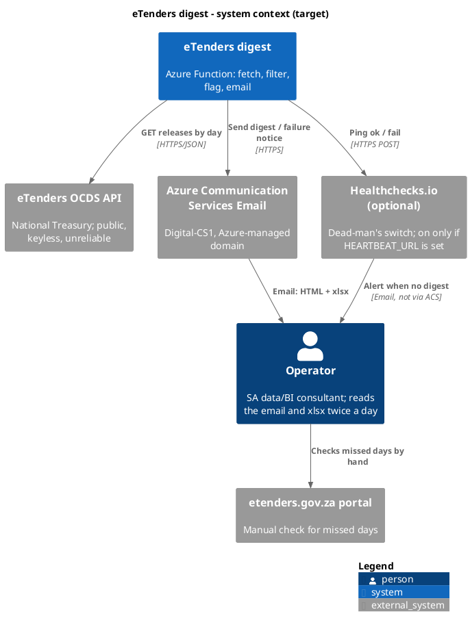
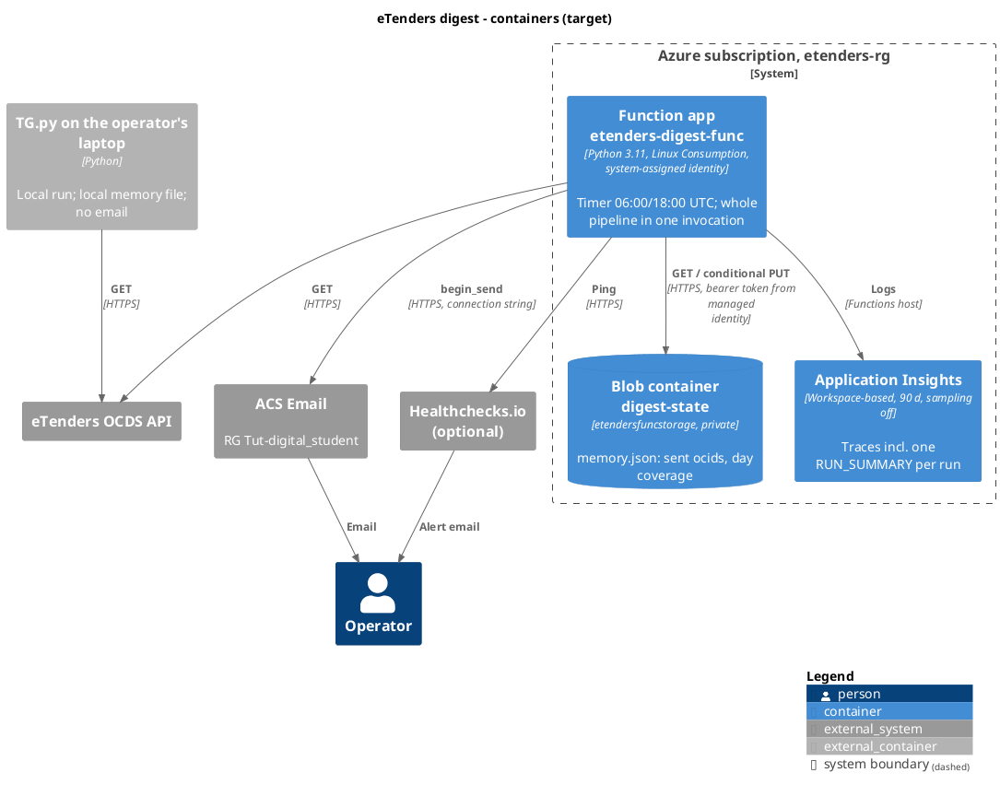
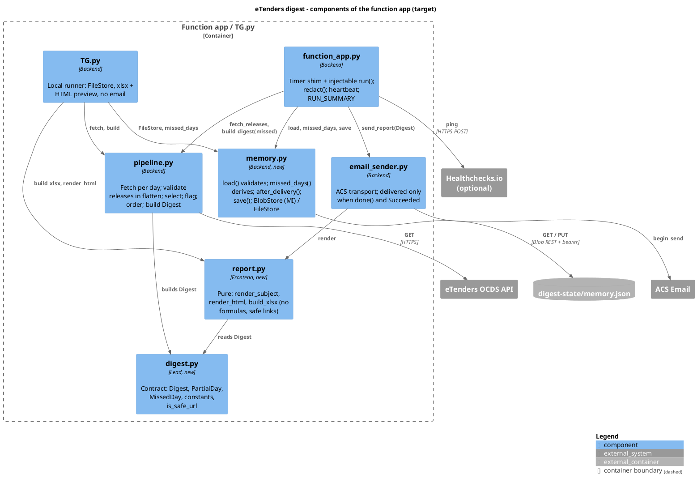
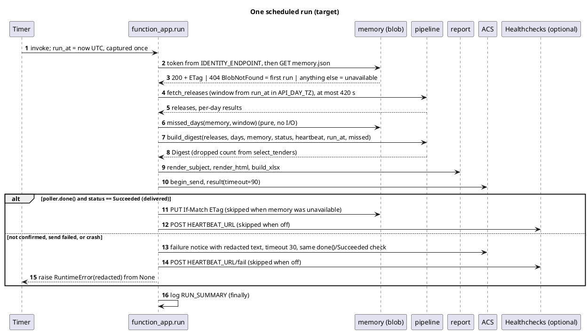
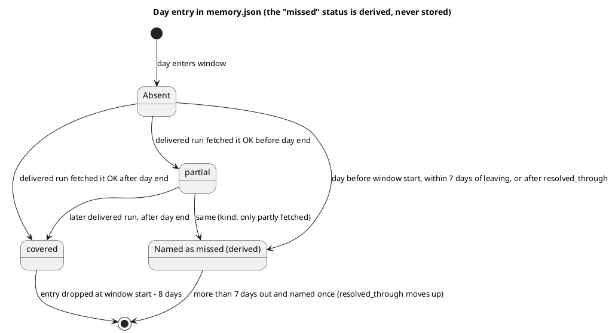
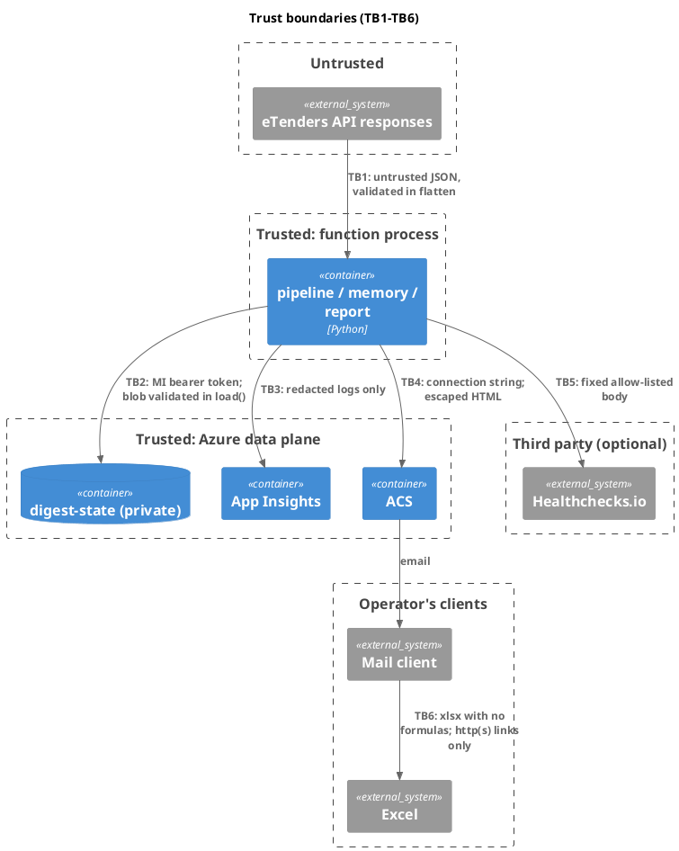

# DESIGN_SPEC: eTenders digest

- **Stage:** 3 (Architect), FULL mode, audit of an existing product
- **Date:** 2026-10-01 · **Version:** 0.4 (reconciled with API_CONTRACT v0.3 and the built code: simplified memory schema; see §18)
- **Baseline:** commit `b7d4996`, plus the uncommitted `.funcignore` change
- **Upstream:**
  - `docs/cosmos/IDEA_BRIEF.md` (SC1–SC9)
  - `docs/cosmos/REQUIREMENTS_PACK.md` v0.2 (FR-01–FR-24, NFR-01–NFR-15, AC-01–AC-40)
  - `docs/adr/0001`–`0026`
  - `docs/cosmos/design-review/SECURITY_DESIGN_REVIEW.md` (S-01–S-11) and `DEVOPS_DESIGN_REVIEW.md` (DO-1a–DO-7)
  - `docs/cosmos/API_CONTRACT.md` **v0.3**, which is **authoritative** for the field-level and signature detail (TL-8), including its deviations D-1 to D-21; and `docs/cosmos/IMPLEMENTATION.md` §6
  - `docs/cosmos/TEAM_LEADER_DECISIONS.md` (OP-1–OP-3, TL-1–TL-17)
- **Binding constraints:**
  - the **cost guardrail** (team rules; OP-2; ADR-0026): no new cost without operator approval, and every cost verified at the primary source;
  - the corrected baseline (OP-3): **US$0.068/month ≈ R1.09/month**.
- **Diagrams:** PlantUML with the C4-PlantUML standard library. Each is also saved under
  `docs/diagrams/*.puml`. **None has been rendered or syntax-checked:** `java` and `plantuml` are
  not installed (both report "command not found"), and I installed nothing.
- **Evidence method.**
  - I read every source file, ADR-0001 to ADR-0026, both reviews, API_CONTRACT and the TL decisions.
  - I ran read-only `az ... show/list` queries (§2.2) and `gh repo view` / `gh run list`.
  - I queried the **Azure Retail Prices API** (ZAR and USD, `southafricanorth`) on 2026-09-30 and 2026-10-01.
  - I read the Healthchecks.io pricing page, the GitHub Actions billing docs and Microsoft Learn (managed identities).
  - I checked the xlsx type fix offline in the repo venv.
  - I did **not** call the eTenders API, the identity endpoint, any blob endpoint or Healthchecks. I did not send email, change Azure, edit code or run the tests (no code changed).

---

## 1. Decisions at a glance

| # | Question | Decision | Traces to | Cost, R/month (§9) |
|---|---|---|---|---|
| D-1 | Where does the run memory live? | **One JSON blob**, `digest-state/memory.json`, in the existing `etendersfuncstorage`. It is read and written over **Blob REST with plain `requests`**, using a bearer token from the Function App's **system-assigned managed identity** (Storage Blob Data Contributor on that container only). There is no secret, no new dependency and no new resource. `TG.py` uses a local file. | FR-12, FR-14, FR-15, FR-22, NFR-08e, NFR-12 | ≈ 0.01 (verified) |
| D-2 | When is it written, and what counts as a first run? | It's written **only after the digest is delivered**, where delivered means **`poller.done()` and status `Succeeded`** (O-2). The write uses an ETag-conditional PUT. It's a first run **only** on `404` with `x-ms-error-code: BlobNotFound`. Anything else means unavailable: nothing is marked NEW and nothing is written. | FR-12, AC-06–AC-08, AC-12, AC-27, AC-36, NFR-12 | 0 |
| D-3 | How is silent failure detected? | An **optional dead-man's switch, off by default** (TL-9). A ping is sent only when `HEARTBEAT_URL` is set (a POST, O-3). With it unset, RUN_SUMMARY and the digest footer say heartbeat monitoring is off. The operator chooses A (Healthchecks.io, free), B (an Azure log alert, **adds cost, needs approval**) or C (nothing). | FR-11, FR-24, NFR-06, AC-23, AC-31–AC-33, AC-40 | A: 0 · B: +8.00 · C: 0 |
| D-4 | When is a day covered, and in which timezone? | A day is covered when a delivered run that started at or after the day's end fetched it OK. `API_DAY_TZ` is one constant (SAST). The scheduled runs give the same result under UTC or SAST. | FR-14, AC-10, AC-11, V-02 | 0 |
| D-5 | What does each run log? | One **minimal** `RUN_SUMMARY {json}` per invocation (TL-3, plus `missed_named` capped at 10 dates per TL-10), emitted in `finally`, under 30,000 chars. Sampling is off (`isEnabled: false`). | FR-19, AC-26, AC-34, AC-38 | 0 (inside the free ingestion tier; §9) |
| D-6 | Where does the Excel formula fix go? | In the single builder, `report.build_xlsx` (the `Tenders` sheet only; there's no Coverage sheet, TL-5). Formula cells are forced back to strings. Links must pass `digest.is_safe_url`. | NFR-08c, AC-21 | 0 |
| D-7 | What is the boundary between the backend and the email/xlsx? | **`digest.py`** (Lead-owned) holds the frozen `Digest`, `PartialDay`, `MissedDay`, the constants and `is_safe_url` (TL-1, TL-7). The backend builds a `Digest`, and a pure **`report.py`** (Frontend) renders it. `email_sender.py` is transport only. | FR-13, FR-16–FR-18, NFR-13 | 0 |
| D-8 | How are untrusted inputs handled? | API releases are shape-checked in `flatten`. A release that isn't a dict, or whose `ocid` isn't a non-empty `str` of ≤ 200 chars, is dropped and counted (D-8). The memory gets **lighter** validation (TL-2): ≤ 5 MB, parse, `schema == 1`, convert types, clamp dates; any error → unavailable. | NFR-03, NFR-05, NFR-14, FR-23, AC-28, AC-29, AC-39 | 0 |
| D-9 | How are secrets kept out of logs and email? | **Containment** (TL-4). Helpers return status strings and never raise or chain exceptions that carry URLs or headers. One `redact()` is applied to the failure-notice text and the top-level exception log and re-raise. `urllib3` and `azure` loggers are held at WARNING. The leak test is AC-30. There's **no** root `RedactingFilter`. | NFR-08a, NFR-15, FR-10, AC-30, AC-38 | 0 |

**Cost in one line (§9):** the default design moves the monthly cost from **≈ R1.09** (measured)
to **≈ R1.10** (+≈ R0.01, verified). The only option that adds real cost is heartbeat option B, at
**+R8.00/month** (verified meter price, needs approval).

---

## 2. Design as built (baseline `b7d4996`)

### 2.1 How it runs today

A timer (`function_app.py:12`) calls `build_matches()` (`pipeline.py:276-282`). That fetches
`today−5 … today` one day at a time under a 420 s budget (`pipeline.py:168-196`), then filters and
sorts by score (`pipeline.py:254-273`). `send_report` (`email_sender.py:73-85`) renders the top 25
rows, attaches `df.to_excel` and sends it through ACS. On any exception, a failure notice goes out
over the same ACS channel and the exception is re-raised (`function_app.py:26-32`). Nothing is kept
between runs.

| # | Weakness this design fixes | Evidence |
|---|---|---|
| B1 | "Today" is the host's local date | `pipeline.py:279` |
| B2 | "Now" is read a second time inside the filter | `pipeline.py:262` |
| B3 | ACS `.result()` is unbounded, **and** `LROPoller.result(timeout)` doesn't raise when the time runs out, so a hung send would count as sent (API_CONTRACT §4.4, checked by the Lead in `.venv/.../azure/core/polling/_poller.py:314-338`) | `email_sender.py:70` |
| B4 | `TG.py` writes a raw xlsx | `TG.py:16` |
| B5 | `MAX_PAGES` truncates silently | `pipeline.py:140` |
| B6 | Traces can be sampled | `host.json:6-9` |
| B7 | One malformed release crashes the run (S-04) | `pipeline.py:122-124`, `192`, `221-251` |
| B8 | Exception text goes to logs and email unredacted (S-02) | `function_app.py:27`; `email_sender.py:92` |

### 2.2 Azure and GitHub topology (read-only, 2026-09-30/10-01)

| Resource | Relevant facts |
|---|---|
| Storage `etendersfuncstorage` (`etenders-rg`, southafricanorth) | StorageV2, **Standard_LRS, access tier Hot**; public blob access off; TLS 1.2; HTTPS only. Blob soft delete is 1 day; versioning is off. `digest-state` doesn't exist yet. |
| Function app `etenders-digest-func` | Linux, Dynamic (Consumption), **no managed identity**; SCM and FTP basic auth are allowed; no slots |
| Application Insights | Workspace-based (`DefaultWorkspace-…-JNB`), retention 90 days, no ingestion sampling; no alert rules |
| ACS `Digital-CS1` + `Digital-EMS` | RG `Tut-digital_student`, untagged, no lock. The managed domain allows 5 emails/min and 10/hour per subscription. |
| GitHub repo | **PRIVATE** (`gh repo view`). 9 workflow runs between 17 and 25 Sep, each 0.6–2.7 min of wall time (`gh run list`). |

---

## 3. C4 diagrams (PlantUML)

Each block is identical to its file under `docs/diagrams/`. None has been rendered.

### 3.1 Level 1: system context (`docs/diagrams/c4-context.puml`)



### 3.2 Level 2: containers (`docs/diagrams/c4-container.puml`)



The only additions are a container inside the existing storage account, a system-assigned identity
(a property of the existing app) and one container-scoped role assignment. **There is no new billable
resource** (§9).

### 3.3 Level 3: components (`docs/diagrams/c4-component.puml`)



There are three new modules. Each earns its place:
- `digest.py` is the contract-first boundary between the two engineers (TL-7). It holds types and
  constants plus the 10-line `is_safe_url` (TL-1).
- `memory.py` is the only stateful I/O, and it can be swapped for a file (FR-22, NFR-10).
- `report.py` is pure rendering, owned by Frontend.

### 3.4 Run sequence (`docs/diagrams/run-sequence.puml`)



---

## 4. Stack and justification

| Layer | Choice | Justification |
|---|---|---|
| Host | Azure Functions, Linux Consumption, Python 3.11, timer | ADR-0001, 0002. The migration is ADR-0022 (DevOps, stage 8). |
| HTTP | `requests==2.34.2`, **reused** for the token, Blob REST and heartbeat | 0 new dependencies (NFR-09, NFR-11) |
| Blob auth | System-assigned MI → `IDENTITY_ENDPOINT` token → `Authorization: Bearer`, `x-ms-version: 2021-08-06` | No secret, no expiry, least privilege (S-01). **No extra cost** (§9). |
| Data | pandas 3.0.6 DataFrame | The existing contract. Nulls read back as `NaN`, so test with `pd.isna` (API_CONTRACT §2.3). |
| xlsx | openpyxl via `pd.ExcelWriter` plus post-processing | FR-18; NFR-08c |
| Email | `azure-communication-email==1.1.0`, with the delivered check | ADR-0007; B3 / O-2 |
| Heartbeat | Healthchecks.io, **optional, off by default** | D-3; TL-9 |
| Tests | pytest, offline fakes | NFR-10 |

**Not added:** `azure-storage-blob`, `azure-identity`, `azure-data-tables`, OpenTelemetry, Jinja2,
Durable Functions, a database, SAS tokens or a root log filter.

---

## 5. Data model

### 5.1 Run memory: `digest-state/memory.json`

`MEMORY_URL = "https://etendersfuncstorage.blob.core.windows.net/digest-state/memory.json"` is a
non-secret constant in `memory.py` (T-10).

```json
{
  "schema": 1,
  "tracking_since": "2026-09-25",
  "resolved_through": "2026-09-24",
  "sent": { "ocds-9t57fa-123456": { "first_sent": "2026-09-30T06:07:41Z", "closing": "2026-10-15T09:00:00Z" } },
  "days": { "2026-09-29": "covered", "2026-09-30": "partial" }
}
```

This is the schema after TL-15: it was simplified **before the first deploy**, so no migration is
needed. The stored `missed` map and the fields that were only written and never read
(`updated_at`, `updated_by_run`, `days[].at`) are **gone**. `load()` ignores them if an old blob
has them, and never writes them back.

| Field | Meaning | Pruned |
|---|---|---|
| `tracking_since` | Window start of the first run with memory. Earlier days are never reported (ADR-0013). | never |
| `resolved_through` | The last day a delivered digest has already accounted for. After a delivery it moves up to `window[0] − 1`. | — |
| `sent[ocid]` | `first_sent`: the first **delivered** digest that contained the `ocid`. `closing`: the latest known closing time, refreshed on each delivery. | when `run_at > max(first_sent + 90 d, closing + 30 d)`; a null closing → `first_sent + 90 d` (OQ-BA4) |
| `days[D]` | `"partial"`: fetched OK only by delivered runs that started before D ended. `"covered"`: fetched OK by a delivered run that started at or after D ended. An absent day was never fetched OK. | `after_delivery` keeps an entry until `window[0] − 8`, so the 7-day reporting period can be derived |

**`missed_days(memory, window) -> list[MissedDay]` is derived** (pure; `None` gives `[]`; API_CONTRACT §3.3).
A day is named when it is before `window[0]`, **not** `covered`, **not** before `tracking_since`, and
**either** within its reporting period (`day ≥ window[0] − 8`, so it left the window at most 7 days
ago, OQ-BA2) **or** after `resolved_through` (no delivered digest has named it yet, AC-12). Its kind is
`only_partly_fetched` for a `partial` day, otherwise `never_fetched`. `left_window_on` is
`day + LOOKBACK_DAYS + 1`.

**Behaviour change from v0.3 (accepted, TL-15):** a day older than its reporting period that is named
once after a long gap is not repeated afterwards. FR-15 and AC-09 to AC-12 still hold, and the
7-day behaviour the operator chose (OQ-BA2) is kept.

**Size:** about 25–37 selected tenders per day × 90–120 days × about 110 B gives about 0.3–0.5 MB. It
is dominated by `sent`, which didn't change; the removed fields were a few hundred bytes. `load()`
logs a warning above 2 MB. The hard cap is 5 MB.

#### Day-state lifecycle (`docs/diagrams/memory-day-states.puml`)



### 5.2 Loading memory (TL-2, S-10, DO-1a)

`load(store, run_at) -> (memory | None, status, etag)` **never raises**. It runs this sequence, and
**any error at any step means `unavailable:<reason>`**:
1. Token (blob only) → `no_identity` / `token`.
2. GET → `200`, or `404 + BlobNotFound` → **`first_run`** (the only first-run case; a missing
   local file for `FileStore`). Anything else → `ContainerNotFound` / `http_<code>` /
   `timeout` / `network`.
3. Read at most 5 MB + 1 byte → `too_large`.
4. `json.loads` → `bad_json`.
5. `schema == 1` → `schema`.
6. **Convert types:** `tracking_since` and `resolved_through` (dates), `sent` (UTC datetimes with an
   offset; `closing` may be null), `days` (a map of date to `partial` or `covered`). Any conversion error →
   `invalid:<key>`, naming the top-level key. Only `(KeyError, TypeError, ValueError, AttributeError)`
   are caught, and only around this step (NFR-05).
7. **Clamp** (not an error): `first_sent ≤ run_at`; `closing ≤ run_at + 365 d`;
   `resolved_through` held between the run date − 366 days and the run date (AC-39; the old
   `report_until` clamp went with the `missed` map).

There are **no** exact-key-set checks and **no** per-map entry caps (TL-2). Unknown keys are ignored
on read and not written back. The `ocid` keys are bounded at the source, because `flatten` drops
any `ocid` over 200 chars (D-8).

| Status | Digest effect | Save after delivery? |
|---|---|---|
| `ok` | Normal | Yes, `If-Match` |
| `first_run` | All rows NEW, plus the first-run notice; no missed days | Yes, `If-None-Match: *` |
| `unavailable:*` | Nothing NEW (`new_count = None`), no missed days, the "unavailable" banner | **No** (`memory.write = "skipped"`, AC-27, AC-28) |

`save()` returns `ok` / `conflict` / `failed:<reason>` and never raises. It retries once after 5 s,
on a timeout or network error only.

**Reset runbook (DEPLOY_PLAN):**
- For `bad_json`, `too_large`, `schema` or `invalid:*`: delete `memory.json`, and the next run is a
  clean first run. Or restore a soft-deleted copy within the current **1-day** retention (§9 O-S).
- For `ContainerNotFound`, `no_identity`, `token` or `http_403`: fix the configuration (§6.3).
  Never delete the blob for these.

### 5.3 The `Digest` contract (summary; **API_CONTRACT §2 is authoritative**)

The types live in `digest.py`: `Digest` (frozen, `eq=False`), `PartialDay` and `MissedDay` (frozen).
`DISPLAY_TZ` lives there too (D-1, D-2).

| `Digest` field | Notes |
|---|---|
| `run_at`, `window` | One UTC clock; the window is in `pipeline.API_DAY_TZ` |
| `tenders` | Exactly `digest.TENDER_COLUMNS`, in the FR-13 order (a stable sort: `is_new` ↓, `score` ↓, `closing` ↑ NaT last, `tender_number` ↑ null last, `ocid` ↑); index `0..n-1`; the Frontend never re-sorts and never mutates it |
| `total`, `new_count` (`None` iff unavailable), `closing_soon_count` | Plain fields, computed once (D-4) |
| `closing_soon_days` | `pipeline.CLOSING_SOON_DAYS`, for the wording "closing within N days" (**D-3**, adopted) |
| `partial_days: tuple[PartialDay(day, reason)]` | **No `covered_earlier`** (TL-6) |
| `missed_days: tuple[MissedDay(day, kind, left_window_on)]` | Empty unless `memory_status == "ok"` |
| `memory_status` | `ok` \| `first_run` \| `unavailable` |
| `heartbeat` | `on` \| `off` \| `misconfigured` → footer |
| `dropped_releases` | → footer when > 0 (FR-23) |

`tenders` columns, nulls and validation are in API_CONTRACT §2.3 and §4.1.
- `days_left = ceil((closing − run_at)/1 d)`.
- `closing_soon ⇔ run_at < closing ≤ run_at + closing_soon_days`.
- `is_new`: all True on `first_run`, all False on `unavailable`.
- `document_urls`: up to 3, each passing `is_safe_url`.

**`digest.is_safe_url(u)`** (TL-1) is the only logic in the contract module. It is True only when:
- `u` is a `str` of ≤ 2,000 chars, with no whitespace and no control characters;
- `urlsplit(u).scheme` is `http` or `https`;
- `urlsplit(u).hostname` is non-empty.

It never raises: a `ValueError` means False. It is applied in `flatten` and again at the sink in `report.py`.

**Frontend rules** (API_CONTRACT §2.6, as amended by TL-5):
- **Rows:** all new or closing-soon rows, plus 25 others.
- **Banners:** missed → partial → unavailable, or the first-run notice.
- **Footer:** heartbeat off; dropped count.
- **Subject:** counts only.
- **Escaping:** `_e()` at every interpolation; no API value in `style`, `class` or names; the link host shown.
- **Time:** SAST; the xlsx gets naive SAST datetimes.
- **The xlsx has a single `Tenders` sheet** (no `Coverage` sheet, TL-5).
- **`TG.py`** writes the xlsx and an `etenders_digest.html` preview.

---

## 6. Interfaces

### 6.1 Internal (**API_CONTRACT §3 is authoritative**; the deltas for v0.3 are listed)

| Module | Public interface | v0.3 notes |
|---|---|---|
| `digest.py` (Lead) | `DISPLAY_TZ`, `MEMORY_STATUSES`, `HEARTBEAT_STATES`, `MISSED_KINDS`, `TENDER_COLUMNS`, `PartialDay`, `MissedDay`, `Digest`, **`is_safe_url`** | `is_safe_url` moves here (TL-1); `PartialDay` loses `covered_earlier` (TL-6) |
| `pipeline.py` | `window_for`, `day_end_utc`, `fetch_releases → (releases, list[DayResult])`, `flatten → dict \| None`, `select_tenders → (df, dropped)`, `build_digest(releases, days, memory, status, heartbeat, run_at, missed=())` | `DayResult(day, ok, reason)`: **no `releases`, `date_min` or `date_max`** (TL-3). **`pipeline` no longer imports `memory`** (N-3, D-19): `function_app` and `TG.py` call `memory.missed_days` and pass the result in as `missed`. It re-exports `is_safe_url` from `digest`. |
| `memory.py` | `MEMORY_URL`, `mi_token() → (token \| None, status)` (**D-5**), `BlobStore`, `FileStore`, `load`, `missed_days(memory, window)` (derived, **D-20**), `after_delivery(memory, digest, day_results, run_at)` (**D-20**: no `run_id`), `save` | Lighter validation (TL-2); the stored `missed` map is gone (TL-15) |
| `report.py` (Frontend) | `render_subject`, `render_html`, `build_xlsx` | **Three public functions only.** No `html_row_count` (TL-3, which supersedes API_CONTRACT D-10). |
| `email_sender.py` | `send_report(d) → {"html_bytes","xlsx_bytes"}`; `send_failure_notice(redacted_text)` | Both **raise unless `poller.done()` and `status == "Succeeded"`** (O-2) |
| `function_app.py` | `redact`, `heartbeat_config`, `ping_heartbeat`, `run(run_at, store, send_report, send_failure_notice, ping, *, run_id, past_due)` (**D-6**), the timer shim | **No `RedactingFilter`** (TL-4). It sets the `urllib3` and `azure` loggers to WARNING at import. |
| `TG.py` | `main()` | `FileStore`; heartbeat off; saves after its files are written (D-7) |

### 6.2 External

| Interface | Contract | Timeout | On failure |
|---|---|---|---|
| eTenders API | Unchanged. A non-list `releases` → `ValueError` (retried); 50 pages → `page limit`; an HTTP error → `http_<code>` (D-11) | 150 s / 2 attempts / 420 s budget | `DayResult(ok=False)` |
| MI token | `GET {IDENTITY_ENDPOINT}?resource=https://storage.azure.com/&api-version=2019-08-01`, header `X-IDENTITY-HEADER` | 5 s, no retry | `no_identity` / `token`, with no blob call (AC-36). **Not verified live** (R-8, V-06). |
| Blob GET / PUT | API_CONTRACT §4.3 | 10 s; PUT retried once | statuses §5.2 |
| **ACS** | `poller = begin_send(msg)`; `result = poller.result(timeout=90 \| 30)`. **Delivered only when `poller.done()` is true and `result["status"] == "Succeeded"`.** Otherwise raise, and the caller treats it as not delivered (**O-2**). | 90 s digest / 30 s notice | Failure path; the memory isn't written (AC-06) |
| **Heartbeat** (when `on`) | **`requests.post(target, json=body, timeout=5, allow_redirects=False)`** (**O-3**). The body is exactly `{"run_id","outcome","counts"}`, and only the status is used. | 5 s | `failed:<Class>` / `http:<code>`; never raised (AC-40) |

### 6.3 Configuration

| Item | Secret? | Missing or wrong → |
|---|---|---|
| `ACS_CONNECTION_STRING`, `SENDER_EMAIL`, `RECIPIENT_EMAIL` | first yes | Crash → failure path |
| System-assigned identity + **Storage Blob Data Contributor** on `…/containers/digest-state` (stage 8) | no | `unavailable:no_identity` / `http_403` + banner |
| Container `digest-state`, private (stage 8) | no | `unavailable:ContainerNotFound` + banner |
| `HEARTBEAT_URL` (optional; **unset by default**) | yes (a capability URL) | Unset → `off`; a wrong prefix (`https://hc-ping.com/`) → `misconfigured`; the footer says so |
| `MEMORY_URL` (code constant) | no | One edit at the Flex migration |

`TG.py` never requests a token, so it can't change production memory (FR-22).

---

## 7. Trust boundaries (`docs/diagrams/trust-boundaries.puml`)



| TB | Control |
|---|---|
| TB1 API → Function | **D-8:** `releases` must be a list; each release must be a dict; `_obj`/`_text` accessors; xlsx-illegal characters stripped; an `ocid` must be a non-empty `str` of ≤ 200 chars, or the release is dropped and counted; `is_safe_url`; `MAX_PAGES`. No blanket `except` (NFR-05). |
| TB2 Function ↔ Blob | MI token (no secret); a container-scoped role; a private container; no PII; first run only on `BlobNotFound`; the lighter validation in `load()` (§5.2). A tampered blob can at worst hide NEW flags or missed days, and the run never crashes. |
| TB3 Function → logs / email / host | **Containment (TL-4):** blob, token and heartbeat helpers catch `requests.RequestException` inside themselves and return a status. They never raise, wrap or chain, and they never log the token, the `IDENTITY_HEADER`, the token response body or a URL. One `redact()` covers the configured `HEARTBEAT_URL` and its path, `IDENTITY_HEADER`, `Bearer \S+`, JWT-shaped strings, `"access_token": …`, `accesskey=…` and `(sig\|se\|sv\|sp\|si)=…`. It is applied to the failure-notice text, the top-level `logging.exception` message and the re-raise (`RuntimeError(redact(...)) from None`). The `urllib3` and `azure` loggers sit at WARNING. Leak test: AC-30. **Residual:** an unexpected library log line containing the heartbeat URL is not filtered. That's low sensitivity (S-03), and Security re-checks it at stage 7. |
| TB4 Function → ACS → mailbox | §5.3 escaping (S-06); inline styles only |
| TB5 Function → Healthchecks (optional) | Off by default; the prefix check; the fixed allow-listed body; a POST with `allow_redirects=False`; the response ignored; the URL redacted; 2FA on the account (the operator) |
| TB6 Email → Excel | D-6: no formula cells; links via `is_safe_url` |
| CI → Function | Stage 8 (S-07, S-08) |
| Transport | Never `verify=False`; use `REQUESTS_CA_BUNDLE` locally (S-11) |

---

## 8. The design questions in detail

### 8.1 Run memory

| Option | New deps | Secret | Extra cost | Verdict |
|---|---|---|---|---|
| **Blob REST + `requests` + MI** | 0 | none | ≈ R0.01 (§9) | **Chosen** |
| Blob REST + SAS | 0 | expiring SAS | same | Superseded (S-02, DO-1b) |
| `azure-storage-blob` + `azure-identity` | 3 + `cryptography` | none | same | Rejected (NFR-11) |
| Functions blob bindings | 0 | none | same | Rejected: they fail the invocation (AC-08) and can't be used from `TG.py` |
| Table storage | 1 | key or MI | not priced | Rejected: more code |

### 8.2 Silent-failure detection: optional, **off by default** (TL-9, OP-2)

| Option | Catches "didn't run"? | Independent of ACS? | Cost (§9) | Status |
|---|---|---|---|---|
| **C. None** (`HEARTBEAT_URL` unset) | No | — | R0 | **Default.** The footer says so; FR-11 and NFR-06 are not met (R-1). |
| A. Healthchecks.io | Yes | Yes | R0 (Hobbyist: 20 jobs, we use 1). **Email alerts on the free plan are unverified**; the operator confirms at sign-up (TL-9). | No cost, but a new third-party account, so it's the operator's choice |
| B. Azure log-search alert → action group email | Yes | Yes | **+R8.00/month** (verified meter; §9 O-B). The action-group email allowance is unverified. | **Adds cost: needs operator approval** |

Recommended A setup: a cron check `0 6,18 * * *` UTC with a 60-minute grace (DO-1c), 2FA, and
alerts to a mailbox that doesn't depend on ACS.

### 8.3 Covered-day semantics and timezone (FR-14, V-02)

- `run_at` is UTC, captured once.
- The window is `run_at.astimezone(API_DAY_TZ).date() − LOOKBACK_DAYS … that date`.
- `day_end_utc(D)` is 00:00 on D+1 in `API_DAY_TZ`.
- D is covered when `run_at ≥ day_end_utc(D)`, `DayResult(D).ok`, and the digest was delivered.

At 06:00 and 18:00 UTC, the SAST and UTC dates are the same, and the first run that can cover D is
06:00 UTC on D+1 under either convention. So V-02 changes no scheduled-run behaviour. TL-3 dropped
the `date_min`/`date_max` evidence on these grounds. **What's left:** an off-schedule (manual) run
between 22:00 and 24:00 UTC could mis-window by a day (T-6). V-02 stays open as a QA validation
item, using cached data or an allowed call. If it changes, the fix is one constant. A truncated day
→ `page limit`, never covered.

### 8.4 Per-run observability: minimal RUN_SUMMARY (TL-3, AC-26, AC-34)

```
RUN_SUMMARY {"v":1,"run_id":"…","started_at":"2026-09-30T06:00:01Z","duration_s":318.2,"past_due":false,
 "window":["2026-09-25","2026-09-30"],
 "days":[{"day":"2026-09-30","ok":true},{"day":"2026-09-26","ok":false,"reason":"ReadTimeout"}],
 "dropped_releases":0,"counts":{"total":182,"new":31,"closing_soon":12},"missed_named":["2026-09-19"],
 "memory":{"read":"ok","write":"ok"},"email":{"html_bytes":58211,"xlsx_bytes":40210},
 "outcome":"digest_delivered","error":null,"heartbeat":"off"}
```

- **TL-3's list:** outcome, counts, per-day ok/reason, memory status, heartbeat status, email bytes.
- **Also kept, each tied to a requirement** (as in API_CONTRACT v0.2 §3.8):
  - `missed_named`, the ISO dates of the permanently missed days named in this digest, **capped at
    10** (TL-10; AC-26, FR-19). It's the only log-side evidence of lost days (SC1). API_CONTRACT
    v0.2 doesn't have it yet (H-1).
  - `window` (the dates requested; AC-26);
  - `run_id` (correlation);
  - `started_at` (needed for the SC1 query);
  - `duration_s` (NFR-02);
  - `past_due` (FR-01);
  - `dropped_releases` (FR-23 requires it);
  - `error`, the class name only (AC-26: the outcome).
- **Dropped (TL-3):** `new_lag_hours`, `became_covered`, `newly_missed`, `counts.html_rows`,
  `fetch_s`, `date_min`/`date_max`, `days[].releases`, `memory.bytes`.
- `outcome` ∈ `digest_delivered` | `failure_notice_delivered` | `nothing_delivered`. A send that
  times out is **not** delivered (O-2). `heartbeat` ∈ `ok` | `failed:<Class>` | `http:<code>` | `off` | `misconfigured`.
- Every `reason` is ≤ 60 chars, `missed_named` holds ≤ 10 dates, and the line is < 30,000 chars (AC-34, whose worst case the BA restates per TL-11 / O-8: 6 failed days with long reasons plus 10 missed dates).
- `host.json` has `samplingSettings.isEnabled: false` (AC-38). The ingestion cost is in §9 C8.

**What stays measurable (unrun KQL, H-5):**
- **SC5** from `outcome` (60 scheduled slots in 30 days).
- **SC1** from `days[]` + `started_at` + `outcome`: a day is covered if any `digest_delivered`
  run with `started_at ≥ day + 22 h` (UTC; the end of day in SAST) has that day `ok`.
- **SC6 (freshness) is no longer measurable from logs** after TL-3 (R-10). The operator can
  measure it by hand from the xlsx `published` column against the email's time.

```kusto
let S = traces | where timestamp > ago(30d) and message startswith "RUN_SUMMARY "
        | extend s = parse_json(substring(message, 12));
// SC5
S | summarize delivered = countif(tostring(s.outcome) != "nothing_delivered")
  | extend pct_of_scheduled = round(100.0 * delivered / 60, 1);
// SC1: covered days in the last 30 days
S | where tostring(s.outcome) == "digest_delivered"
  | mv-expand d = s.days | where tobool(d.ok)
  | extend day = todatetime(tostring(d.day)), started = todatetime(tostring(s.started_at))
  | where started >= day + 22h
  | summarize covered_days = dcount(day)
  | extend pct = round(100.0 * covered_days / 30, 1);
// SC1, the "named somewhere" half: permanently missed days reported in the last 30 days
S | mv-expand m = s.missed_named to typeof(string) | summarize missed_days = dcount(m);
```

### 8.5 Excel formula injection (NFR-08c, AC-21, S-05)

- `report.build_xlsx` is the single writer (the `Tenders` sheet only; TL-5), and `TG.py` uses it.
  Before saving, every cell openpyxl marked `"f"` gets `data_type = "s"`. There's no `'` prefix;
  `quotePrefix` is optional.
- Hyperlinks are set only on URLs that pass `digest.is_safe_url`.
- **Verified offline** (repo venv): `=HYPERLINK(...)` is stored as `f` without the fix and `s` with
  it, with no `<f>` in the XML, and dates stay `d`.
- **AC-21:**
  - The payloads (`=1+1`, `+1+1`, `-1+1`, `@SUM(A1)`, `\t=1+1`, `\r=1+1`, the DDE payload, and
    `=HYPERLINK(...)`) go into **text columns of the `Tenders` sheet**, such as `title`, `buyer`
    and `blockers`. Assert `data_type == "s"` after `load_workbook`, and that no `<f>` appears in
    any sheet XML.
  - `PartialDay.reason` no longer reaches the xlsx (there's no Coverage sheet). Its escaping is
    covered in HTML by AC-35.
  - Link cases: `javascript:`, `file://`, UNC, `https://` with no host, embedded whitespace, and
    over 2,000 chars. None of them may become a hyperlink.

### 8.6 Email and xlsx boundary

- The backend decides what is true; `report.py` decides how it looks (§5.3).
- HTML ≤ 100 KB at 60 rows (Gmail's clipping point of about 102 KB is unverified).
- The ACS request is ≤ 10 MB including base64 (verified at Microsoft Learn on 2026-09-30).
- Accessibility: `<th scope="col">`; flags as text; contrast ≥ 4.5:1.

---

## 9. Cost budget (owned by the Architect; binding on DevOps and Security)

**Currency.** The subscription bills in **US$**. Every rand figure is Microsoft's own ZAR price from
the **Azure Retail Prices API** (`https://prices.azure.com/api/retail/prices`, `currencyCode=ZAR`,
`armRegionName eq 'southafricanorth'`, queried 2026-09-30 and 2026-10-01, `type = Consumption`).
**Rate check:** Hot LRS Data Stored is US$0.0219 vs R0.3504, and Hot LRS Write Operations is
US$0.06 vs R0.9599. Both give **R16.00 per US$**, which matches OP-3.

**Baseline (measured, OP-3):** **US$0.068/month ≈ R1.09/month** (Cost Management, 17–30 Sep 2026,
US$0.00228/day on average). The Team Leader supplied it; I didn't re-measure it.

**v0.4 check:** TL-15 shrinks the memory blob slightly (the stored `missed` map and three never-read fields are gone, while `sent` dominates the size), so C1 can only fall. The operation counts (C2, C3) are unchanged: one GET and one PUT per run. **The budget in this section holds unchanged at ≈ R1.10/month.**

**Usage assumptions:**
- 2 runs a day, so 60 runs a month;
- memory.json ≤ 0.5 MB typical, with a 5 MB cap;
- one GET and one PUT per run (plus a rare retry);
- the email volume is unchanged.

### 9.1 Components the default design adds

| # | Component | Price (source, date) | Free tier / limit | Our usage | R/month |
|---|---|---|---|---|---|
| C1 | `digest-state` blob capacity | Hot LRS Data Stored **R0.3504 /GB-month** (Retail API; the account is Hot / Standard_LRS per `az`) | none | ≤ 0.5 MB (cap 5 MB) | **R0.0002** (≤ R0.0017 at the cap) |
| C2 | Blob writes (PUT) | Hot LRS Write Operations **R0.9599 /10K** (Retail API) | none | 60, ≤ 120 with retries | **R0.006** (≤ R0.012) |
| C3 | Blob reads (GET) | Hot Read Operations **R0.064 /10K** (Retail API) | none | 60 | **R0.0004** |
| C4 | Create container (one-off) | List and Create Container Operations **R0.9599 /10K** (Retail API) | — | 1, once | < R0.0001, once |
| C5 | System-assigned managed identity + 60 token requests | "Managed identities can be used at no extra cost" (Microsoft Learn, *Managed identities for Azure resources*, fetched 2026-10-01) | — | 1 identity | **R0** |
| C6 | Role assignment (Storage Blob Data Contributor) | **Unverified.** I found no Retail Prices meter and didn't check further. Azure RBAC isn't expected to be billed. | — | 1 | R0 (**unverified**) |
| C7 | Log ingestion with sampling **off** | Analytics Logs Data Ingestion: **R0.00 for the first 5 GB/month, then R53.7555 /GB** (Retail API tiers). Whether the 5 GB is per billing account or per workspace isn't stated in the API (**unverified**). | 5 GB/month | RUN_SUMMARY ≈ 1 KB × 60 ≈ **0.06 MB/month**. **Current total ingestion is unverified**: `az monitor log-analytics query` isn't available here (missing CLI extension), and I didn't install it. The R1.09 baseline bill implies today's ingestion is inside the free tier (an inference). Turning sampling off at 2 runs/day is expected to add almost nothing; whether sampling drops anything today is unverified. | **R0** while total ingestion < 5 GB |
| C8 | Retention (App Insights 90 days, unchanged) | Analytics Logs Data Retention **R2.3998 /GB-month** beyond the included period (Retail API). The included period for App Insights tables is **unverified**. | — | The setting is unchanged; the added data is ≈ 0.06 MB/month | R0 change (**unverified**) |
| C9 | ACS email | Unchanged volume (1 digest per run; notices as today) | — | unchanged | R0 change |
| C10 | Heartbeat: **default C (none)** | — | — | — | **R0** |
| C11 | GitHub Actions (**private** repo) | GitHub Free includes **2,000 min/month** for private repos. With no payment method, usage is **blocked** once the quota is used up (docs.github.com, *GitHub Actions billing*, fetched 2026-10-01). Per-job rounding isn't stated (**unverified**), and the operator's GitHub plan is **unverified** (Free assumed). | 2,000 min | Measured: 9 runs from 17 to 25 Sep, each 0.6–2.7 min of wall time, 2 jobs per run. Assume ≤ 6 billed min per run × ≤ 30 pushes a month ≈ **≤ 180 min**. The new tests add seconds. | **R0** |
| C12 | Outbound data (blob in the same region; the optional heartbeat) | The egress free allowance is **unverified** | — | < 1 MB/month | ≈ R0 (**unverified**) |
| | **Default design total** | | | | **≈ R1.09 + R0.01 ≈ R1.10/month** |

All the verified Azure meters added by default come to **≈ R0.0066/month** (C1 + C2 + C3), which
rounds to R0.01.

### 9.2 Options that are not the default

| # | Option | Price (source) | Our usage | R/month | Approval |
|---|---|---|---|---|---|
| O-A | Heartbeat A: Healthchecks.io | Hobbyist **$0/month, 20 jobs, 100 log entries per job** (healthchecks.io/pricing, 2026-09-30) | 1 job, about 60 pings/month | **R0** | No cost. The operator decides (a third-party account). **Email alerts on the free plan are unverified** (TL-9). |
| O-B | Heartbeat B: Azure log-search alert rule, 15-min frequency | Meter "Alerts System Log Monitored at 15 Minute Frequency": **R7.9993 /month** per rule (Retail API, `southafricanorth` and `Global`, 2026-10-01). It's my reading that this meter bills scheduled log-search alert rules, so the **meter mapping is unverified**. Lower frequencies have no cheaper meter listed. The action-group email allowance is **unverified**. | 1 rule | **+R8.00** → total ≈ **R9.10** | **Needs operator approval** (OP-2); it's also over NFR-01's R5 |
| O-M | Metric alert on `requests/failed` (a partial second channel) | "Alerts Metric Monitored": **R0 for the first 10 time series**, then **R1.5999** each (Retail API) | 1 time series | R0 (the alert). The action-group email allowance is **unverified**. | Not proposed. Approval needed if the email isn't free. |
| O-S | Blob soft delete, 1 → 7 days (DO-2) | Soft-deleted data billed at the Hot LRS rate of **R0.3504 /GB-month** (that billing rule is **unverified** here) | **Account-wide:** it also keeps overwritten or deleted host and `scm-releases` blobs. Memory snapshots ≈ 14 × 0.5 MB = 7 MB → R0.0025. Deployment package sizes are **unverified**. | ≈ R0.003 + **unverified** | **Default stays 1 day (R0 change).** 7 days only with operator approval. |
| O-PR | CI tests on pull requests (stage 8) | GitHub Actions minutes (C11) | +1–2 min per PR | R0 while < 2,000 min | Fits inside the free tier |

### 9.3 Rules for later stages

- DevOps and Security must check every recommendation against this budget, and flag anything that
  moves the total above **≈ R1.10/month**.
- These free tiers have ceilings to watch:
  - Log Analytics ingestion (5 GB/month, then R53.76/GB);
  - GitHub Actions (2,000 min, then blocked or billed);
  - Healthchecks (20 jobs).
- V-05 re-measures the real cost in Cost Management one month after go-live.

---

## 10. Trade-offs

| # | Decision | Gain | Give up / risk | Mitigation |
|---|---|---|---|---|
| T-1 | MI + REST | No secret, 0 dependencies, R0 | About 20 lines of hand-written REST; the token endpoint is unverified on Linux Consumption | Degrades to `unavailable` with a banner; DevOps verifies (V-06) |
| T-2 | Write after confirmed delivery (O-2) | "New" means received | A write failure after delivery → a false "new" next run | One retry; logged |
| T-3 | The heartbeat is off by default | No cost, no third party by default | FR-11 isn't met until the operator opts in | The footer on every digest; R-1 |
| T-4 | Outages and rollbacks → `never_fetched` | Nothing is silently dropped | Possible false "missed" days and re-flagged NEW; a long-gap day is named once, not repeated (TL-15) | On the safe side; runbook |
| T-5 | Never hide new or closing-soon rows | Nothing important is hidden | The first run (all rows NEW, measured at about 223 KiB) will clip in Gmail; normal runs measure 67–76 KiB | Accepted by TL-12: a one-off; the xlsx has everything and Gmail's "view entire message" link shows the rest |
| T-6 | `API_DAY_TZ` = SAST, without the date-range evidence (TL-3) | Less code | A manual run between 22:00 and 24:00 UTC could mis-window | One constant; V-02 stays a QA item |
| T-7 | One invocation | Few moving parts | The 10-minute ceiling | §11 budget |
| T-8 | Lighter memory validation (TL-2) | Far less code; it still never crashes or fakes NEW | A well-typed but wrong blob is accepted | The blob is private and only this app writes it |
| T-9 | Drop and count bad releases | One bad record can't block the digest | Dropped tenders are invisible apart from the count | Footer + summary |
| T-10 | The blob URL is a code constant | One setting fewer | The account name lives in code | One edit at the Flex migration |
| T-11 | Redaction by containment, with no root filter (TL-4) | Simpler | An unexpected library log of the heartbeat URL isn't filtered | Loggers at WARNING; the AC-30 leak test; Security re-checks at stage 7 |
| T-12 | Minimal RUN_SUMMARY (TL-3) | A smaller schema and less code | SC6 can't be measured from logs | Measured by hand from the xlsx; R-10 |

---

## 11. Non-functional targets

| NFR | Target | How it's met / measured |
|---|---|---|
| NFR-01 Cost | The guardrail target: **no increase beyond ≈ R0.01/month by default** (≈ R1.10 total). NFR-01's ≤ R5 ceiling is still met. | §9; V-05 |
| NFR-02 Duration | ≤ 565 s worst case | Success path: token 5 + read 10 + fetch 420 + render 5 + ACS 90 + write 25 + ping 5 = 560 s. Failure path: 15 + 420 + 5 + 90 + 30 + 5 = 565 s. |
| NFR-03 Resilience | Malformed data never prevents a digest | D-8; AC-29 |
| NFR-04 Honesty | Complete / partial / missed / unavailable / first run + footer | §5.3 |
| NFR-06 Delivery | With A or B: ≥ 95%, silent gap ≤ 70 min (A, cron) or ≤ 13 h (B). With C (the default): **not met**, and the footer says so. | §8.2 |
| NFR-07 Freshness | Unmeasured from logs after TL-3 | Manual (R-10) |
| NFR-08 / NFR-15 Security | No secrets in the repo, package, logs, email or host exceptions; no formulas; safe links | §7; AC-21, AC-30, AC-35, AC-38 |
| NFR-09 Simplicity | **3** new modules (TL-7); 0 new dependencies | §3.3 |
| NFR-10 Tests | Every AC offline; **≤ 15 s** (TL-13; the build runs in about 4–7 s); import/registration (AC-37) | — |
| NFR-12 / NFR-14 Memory integrity | ≤ 5 MB; first run only on `BlobNotFound`; any error → unavailable; never overwritten | §5.2 |
| NFR-13 Email | HTML ≤ 100 KB at 60 rows; ACS ≤ 7.5 MB raw | §8.6 |
| Observability | 1 RUN_SUMMARY per invocation, unsampled, < 30,000 chars | §8.4 |

---

## 12. Gap table

| Req | Current state (evidence) | Proposed design | ADR |
|---|---|---|---|
| FR-01 | Met; untested | Injectable `run()`; AC-37 | — |
| FR-03 | Met; "out of time" untested | Test it; non-list `releases`; `page limit`; `http_<code>` | 0023 |
| FR-04 | A second "now" (`pipeline.py:262`) | `run_at` | 0017 |
| FR-07 | Met; unconfirmed sends count as sent (B3) | Delivered = `done()` and `Succeeded` (O-2) | 0016, 0020 |
| FR-10 | Unredacted (`function_app.py:27`, `email_sender.py:92`) | Redacted text + re-raise; `/fail` ping when on | 0018, 0024 |
| FR-11 | Not met | Optional heartbeat, off by default; A/B/C | 0018 |
| FR-12 | Not met | `memory.sent`, MI blob, write after confirmed delivery | 0016 |
| FR-13 | Score only (`pipeline.py:273`) | Stable 5-key sort | 0020 |
| FR-14 / FR-15 | Not met | `memory.days` + derived `missed_days()`; coverage rule | 0016, 0017 |
| FR-16 | Not met | `closing_soon`, `days_left`, `closing_soon_days` | 0020 |
| FR-17 | Partly met | `report.render_html`; banners; footer; escaping | 0020 |
| FR-18 | Partly met (`email_sender.py:77-78`) | `build_xlsx`, `Tenders` sheet only, no formulas | 0020, 0021 |
| FR-19 | Partly met (`function_app.py:19`) | Minimal RUN_SUMMARY; sampling off | 0019 |
| FR-22 | Partly met (`TG.py`) | `FileStore`; shared builder; HTML preview | 0016, 0021 |
| FR-23 | Not met | Drop and count in `flatten` | 0023 |
| FR-24 | Not met | `heartbeat_config`; footer | 0018 |
| NFR-01 | Baseline ≈ R1.09 | +≈ R0.01 (§9) | 0026 |
| NFR-02 | Unbounded `.result()` | §11 budget; timeouts plus the delivered check | — |
| NFR-03 | Partly met (B7) | D-8 | 0023 |
| NFR-07 | Unmeasured | Stays unmeasured from logs (TL-3) | 0019 |
| NFR-08a / NFR-15 | At risk (B8) | Containment + `redact()` | 0024 |
| NFR-08c | Not met (`email_sender.py:78`, `TG.py:16`) | D-6 | 0021 |
| NFR-11 | Partly met | No new dependency; the lock is deferred to stage 8 | — |
| NFR-12 / NFR-14 | Not met | §5.2 | 0016, 0023 |
| NFR-13 | Partly met | Size targets | 0020 |

---

## 13. Phase 2 (not designed, not blocked)

- A classification cache would be a separate blob in `digest-state`, under the same role.
- `tenders` can gain columns additively in `digest.py`.
- An LLM step needs its own function, which needs a cost line and approval under the guardrail.

---

## 14. ADRs: amendments for the BA

ADR-0016 to ADR-0026 are recorded. v0.3 needs these amendments:

| ADR | Amendment | Source |
|---|---|---|
| 0016 | "Delivered" means `poller.done()` and status `Succeeded`; a timed-out send is not delivered. The cost is ≈ R0.01/month (verified, §9). | O-2, TL-8, OP-3 |
| 0018 | The ping is a **POST** with a JSON body. **Off by default.** Option B costs **R8.00/month** (verified meter; the mapping is unverified) and needs operator approval. Email alerts on Healthchecks' free plan are unverified. | O-3, TL-9 |
| 0019 | The minimal RUN_SUMMARY field list (§8.4), including `missed_named` (≤ 10 dates); SC6 is no longer measured from logs | TL-3, TL-10 |
| 0020 | The contract lives in `digest.py`, together with `is_safe_url`. Add `closing_soon_days`. Drop `covered_earlier`. `report.py` keeps 3 public functions. | TL-1, TL-6, TL-7, D-3 |
| 0021 | No `Coverage` sheet; the AC-21 payloads go in `Tenders` text columns | TL-5 |
| 0023 | The lighter memory validation (§5.2); `flatten` drops an `ocid` over 200 chars | TL-2, D-8 |
| 0024 | Redaction by containment; no `RedactingFilter` | TL-4 |
| 0026 | §9 is the cost budget it refers to. The baseline is US$0.068 ≈ R1.09. | OP-2, OP-3 |

ADR-0022 remains reserved for DevOps (stage 8). **No new ADR** is needed for v0.3.

---

## 15. Traceability matrix: design column

| Req | Design |
|---|---|
| FR-01 | ADR-0002; `run()`; AC-37 |
| FR-02 / FR-03 | ADR-0003, 0004, 0023; `DayResult(day, ok, reason, releases)` |
| FR-04 | ADR-0014, 0017 |
| FR-07 | ADR-0007, 0016: the delivered check (§6.2) |
| FR-08 | ADR-0003, 0020 (`PartialDay(day, reason)`) |
| FR-10 | ADR-0007, 0018, 0024 |
| FR-11 / FR-24 | ADR-0018 (§8.2) |
| FR-12 | ADR-0012, 0016 (§5) |
| FR-13 | ADR-0012, 0020 (§5.3) |
| FR-14 / FR-15 | ADR-0013, 0016, 0017 (§5.1, §8.3) |
| FR-16 | ADR-0014, 0020 |
| FR-17 / FR-18 | ADR-0015, 0020, 0021 (§5.3, §8.5) |
| FR-19 | ADR-0019 (§8.4) |
| FR-22 | ADR-0016, 0021 |
| FR-23 | ADR-0023 (§7 TB1) |
| NFR-01 | ADR-0001, 0010, **0026; §9 Cost budget** |
| NFR-02 | §11 |
| NFR-03 / NFR-05 / NFR-14 | ADR-0023 |
| NFR-04 | ADR-0013, 0018, 0020 |
| NFR-06 | ADR-0018 |
| NFR-07 | ADR-0019 (unmeasured from logs) |
| NFR-08 / NFR-15 | ADR-0008 (stage 8), 0016, 0021, 0024 |
| NFR-10 | ADR-0009 |
| NFR-11 | ADR-0009 |
| NFR-12 | ADR-0016, 0023 |
| NFR-13 | ADR-0015, 0020 |

---

## 16. Hand-offs

| # | To | Item |
|---|---|---|
| H-1 | Lead Engineer | None open. API_CONTRACT v0.3 includes `missed_named` and the simplified schema (D-18 to D-21), and this spec matches it. |
| H-2 | BA | The §14 ADR amendments; the AC-21a, AC-28 and AC-34 amendments (TL-11; O-6, O-7, O-8); replace every "R0.07" in the IDEA_BRIEF and REQUIREMENTS_PACK with US$0.068 ≈ R1.09 (OP-3); NFR-07 is now unmeasured from logs |
| H-3 | DevOps (stage 8) | Keep within §9. **Verify the MI token endpoint** (V-06). Keep soft delete at 1 day unless the operator approves O-S. Measure the current log ingestion (C7). |
| H-4 | Operator | Choose heartbeat C (default), A (R0; confirm free-plan email) or B (+R8.00, approval). Accept R-1 to R-11. |
| H-5 | QA | V-02 as a validation item; run the §8.4 KQL after go-live |

---

## 17. Design review resolutions

### 17.1 Security

| ID | Resolution | Where |
|---|---|---|
| S-01 | **Folded in:** MI over REST, container-scoped role | D-1, §6, §7 TB2, ADR-0016 |
| S-02 | **Folded in, simplified by TL-4:** containment, `redact()` on the notice, the top-level log and the re-raise, loggers at WARNING, AC-30. The root filter was dropped. **Residual** (T-11), re-checked at stage 7. | D-9, §7 TB3, ADR-0024 |
| S-03 | **Folded in:** optional and **off by default**; prefix check; fixed body; POST without redirects; redacted. **Residual (operator):** 2FA; a leaked URL; service loss (R-2). | D-3, §6.2, §8.2, ADR-0018 |
| S-04 | **Folded in** (+ D-8, the ≤ 200-char `ocid`) | D-8, §7 TB1, ADR-0023 |
| S-05 | **Folded in.** AC-21 applies to the `Tenders` sheet; there's no Coverage sheet (TL-5). | §8.5, ADR-0021 |
| S-06 | **Folded in** | §5.3, ADR-0020 |
| S-07 / S-08 / S-09 | **Deferred to stage 8.** Residual until then (R-4, R-5, R-6). | §17.3 |
| S-10 | **Folded in, lighter (TL-2):** ≤ 5 MB, parse, schema, convert types, clamp; any error → unavailable, never overwritten | §5.2, ADR-0023 |
| S-11 | **Folded in:** never `verify=False` | §7 |

### 17.2 DevOps

| ID | Resolution |
|---|---|
| DO-1a | **Folded in:** first run only on `BlobNotFound` (§5.2) |
| DO-1b | **Moot** (no SAS) |
| DO-1c | **Deferred to stage 8.** The order is: container → identity + role → optional heartbeat → code. Warn that run 1 will be all NEW. |
| DO-2 | **Deferred to stage 8**, and **constrained by §9**: the Bicep creates the container, but soft delete **stays at 1 day** unless the operator approves O-S |
| DO-3 | **Folded in:** `isEnabled: false`; < 30,000 chars (AC-34) |
| DO-4 / DO-5 / DO-6 / DO-7 | **Deferred to stage 8**: rollback `ref` + `concurrency`; ADR-0022; CI hygiene (the AC-37 import test is folded in); resource-group locks and tags. R-7 is residual. |

### 17.3 Team Leader decisions and API_CONTRACT reconciliation (TL-8)

| Item | Resolution in v0.3 |
|---|---|
| OP-1 | All diagrams are PlantUML (§3, §5.1, §7) |
| OP-2 / OP-3 | §9 Cost budget; every old "R0.07/R0.08/R18" figure is replaced |
| TL-1 | `is_safe_url` → `digest.py` (§5.3, §6.1) |
| TL-2 | Lighter memory validation (§5.2) |
| TL-3 | Minimal RUN_SUMMARY; no `html_row_count` (§8.4, §6.1) |
| TL-4 | Redaction by containment; no root filter (§7 TB3) |
| TL-5 | No Coverage sheet; `TG.py` HTML preview kept (§5.3, §8.5) |
| TL-6 | No `covered_earlier` (§5.3) |
| TL-7 | `digest.py`: 3 new modules (§3.3, §11) |
| TL-9 | Heartbeat off by default; A free with email unverified; B adds cost and needs approval (§8.2, §9.2) |
| O-1 | Resolved by TL-1 |
| O-2 | **Adopted:** delivered = `done()` and `Succeeded` (§6.2, D-2, B3) |
| O-3 | **Adopted:** POST (§6.2, diagrams) |
| O-4 | Stays a stage 8 verification (V-06) |
| D-1, D-2, D-4 | **Adopted:** `digest.py`; `DISPLAY_TZ` there; plain fields and tuples |
| D-3 | **Adopted:** `closing_soon_days` |
| D-5, D-6 | **Adopted:** `mi_token → (token, status)`; `run_id` and `past_due` on `run`. (The `run_id` on `after_delivery` was removed again by D-20.) |
| D-7, D-9, D-11 | **Adopted** |
| D-8 | **Adopted:** an `ocid` over 200 chars is dropped |
| D-10 | **Superseded by TL-3:** no `html_rows` (withdrawn in v0.2) |
| D-12 | **Adopted:** `digest.is_safe_url` (TL-1; §5.3) |
| D-13 | **Adopted:** lighter memory validation (TL-2; §5.2) |
| D-14 | **Adopted:** minimal RUN_SUMMARY, plus `missed_named` from TL-10 (§8.4) |
| D-15 | **Adopted:** containment + `redact()` on the notice and the top-level log; no filter (TL-4; §7 TB3) |
| D-16 | **Adopted:** no Coverage sheet, no `covered_earlier` (TL-5, TL-6) |
| D-17 | **Adopted:** POST; off by default (TL-8, TL-9; §6.2) |
| D-18 | **Adopted:** the stored `missed` map, `updated_at`, `updated_by_run` and `days[].at` are removed; `missed` is derived (TL-15; §5.1) |
| D-19 | **Adopted:** `pipeline` no longer imports `memory`; the caller passes `missed` to `build_digest` (N-3; §6.1) |
| D-20 | **Adopted:** `missed_days(memory, window)`; `after_delivery` has no `run_id` (TL-15; §6.1) |
| D-21 | **Adopted:** "tender(s)" wording (TL-17 N-6; Frontend only) |
| TL-12 | Gmail clipping is accepted on the first run only (about 223 KiB, then 67–76 KiB). This amends T-5 and §8.6; no design change. |
| TL-13 | NFR-10's suite-time target becomes 15 s (BA); the old "< 5 s" in §11 is superseded |
| TL-14 | SC6 / NFR-07 stay unmeasured in Phase 1 (consistent with R-10) |
| TL-15 | **Folded in:** the memory schema is simplified before first deploy (§5.1, §5.2, the day-state diagram) |
| TL-16 | Heartbeat kept (option A or B, off by default); the review's O-2 is rejected. §8.2 is unchanged. |
| TL-17 | Review nits N-1 to N-7 are code-level; none changes the design. N-3 is in §6.1. |
| O-5 | **Resolved by TL-10:** `missed_named` is restored, capped at 10, so AC-26 and FR-19 stand |
| O-6 | **TL-11 (BA):** AC-28's "extra key" row becomes "ignored, read ok", matching §5.2 |
| O-7 | **TL-11 (BA):** AC-21a's Coverage-sheet clause is dropped; tested on `Tenders` (§8.5) |
| O-8 | **TL-11 (BA):** AC-34's worst case is restated with only the remaining fields (§8.4) |
| TL-10 | `missed_named` ≤ 10 dates (§8.4) |
| TL-11 | AC amendments by the BA (H-2) |

### 17.4 Residual risks for the operator

| # | Risk |
|---|---|
| R-1 | Heartbeat C (the default) leaves FR-11 and NFR-06 unmet; a total ACS or app failure is silent (the footer says monitoring is off) |
| R-2 | Option A: a leaked URL can mask or forge alerts; if Healthchecks disappears, detection is lost; **free-plan email is unverified** |
| R-3 | Option B adds **R8.00/month** (≈ R9.10 total), against the guardrail |
| R-4 / R-5 / R-6 | Deploy credential, CI supply chain and OneDrive secrets (S-07, S-08, S-09) until stage 8 |
| R-7 | ACS in an unlocked tutorial RG with a shared quota (DO-7) |
| R-8 | The MI token endpoint is unverified; if it fails, the memory is always unavailable (with a banner) |
| R-9 | False "new" after a post-delivery write failure; false "missed" after outages or rollbacks |
| R-10 | SC6 / NFR-07 can't be measured from logs (TL-3) |
| R-11 | Unverified cost items: current log ingestion (C7), RBAC (C6), retention (C8), egress (C12), the Actions rounding and plan (C11), the soft-delete billing rule (O-S), the O-B meter mapping |

---

## 18. Changelog

| Version | Date | Change |
|---|---|---|
| 0.1 | 2026-09-30 | First design (D-1–D-7; ADR-0016–0021 proposed) |
| 0.2 | 2026-09-30 | Folded in the Security and DevOps reviews; MI over REST; D-8, D-9; PlantUML |
| 0.3 | 2026-10-01 | **OP-3:** the baseline is corrected to US$0.068 ≈ R1.09/month, and the guessed R18/US$ is replaced by Microsoft's R16.00 (cross-checked in the Retail Prices API). **New §9 Cost budget**, verified at the primary sources, with the unverified items labelled. The heartbeat is **off by default**, and option B is +R8.00 and needs approval. **TL-8:** reconciled against **API_CONTRACT v0.2**: O-2 (the delivered check), O-3 (POST), D-1 to D-17, O-5 to O-8. **TL-10:** `missed_named` (≤ 10) restored in RUN_SUMMARY. **TL-11:** AC amendments handed to the BA. **TL-1 to TL-7** applied (`digest.py` with `is_safe_url`, lighter validation, minimal RUN_SUMMARY, containment redaction, no Coverage sheet, no `covered_earlier`). Updated `c4-context`, `c4-component` and `run-sequence.puml`. ADR amendments are listed in §14. |
| 0.4 | 2026-10-01 | Reconciled with **API_CONTRACT v0.3** and the built code (IMPLEMENTATION §6). **TL-15:** the memory schema is simplified before first deploy: the stored `missed` map, `updated_at`, `updated_by_run` and `days[].at` are removed, and `missed_days` is derived (§5.1, §5.2, `memory-day-states.puml`). **N-3:** `pipeline` no longer imports `memory`; `function_app` and `TG.py` pass `missed` to `build_digest` (§6.1, `c4-component.puml`, `run-sequence.puml`, `c4-container.puml`). D-18 to D-21 and TL-12 to TL-17 recorded in §17.3; T-4, T-5 and the NFR-10 target updated. The cost budget was re-checked and still holds (§9). |
