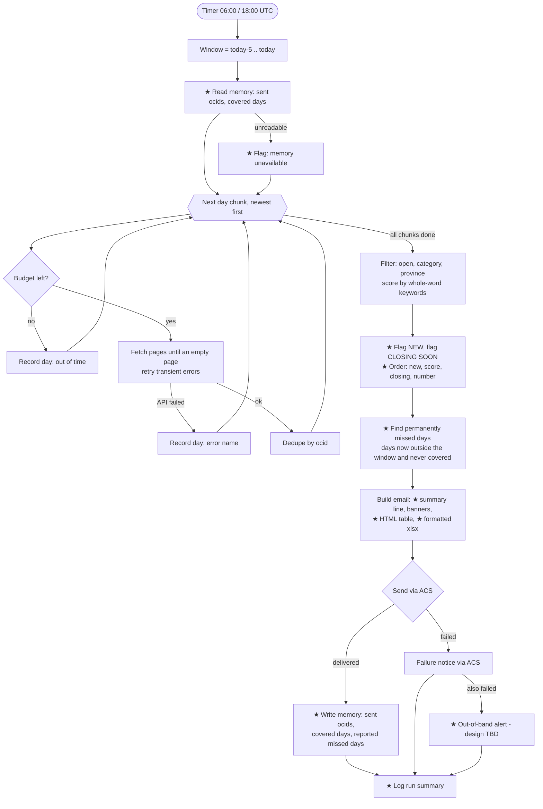
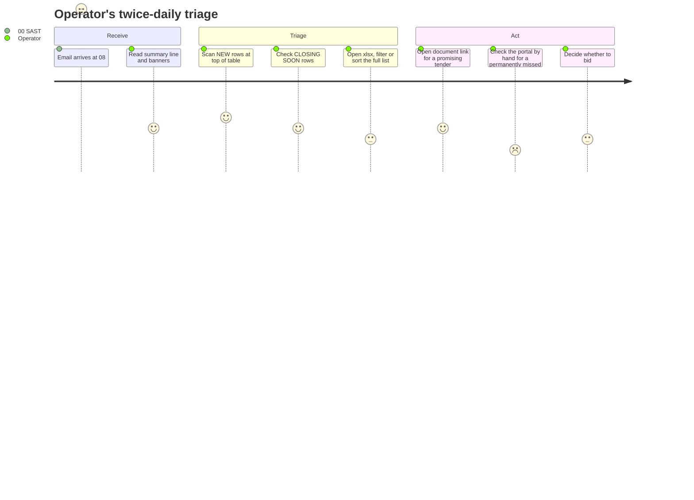

# REQUIREMENTS_PACK: eTenders digest

- **Stage:** 2 (Business Analyst, Requirements mode), FULL mode, audit of an existing product.
  **Updated after stage 3** (Update mode) to fold in DESIGN_SPEC v0.2 and both design reviews.
- **Date:** 2026-10-01 · **Version:** 0.4 (v0.3: OP-1–OP-3 and TL-1–TL-11 folded in, see §1.2; v0.4: the build and TL-12–TL-17, see the changelog)
- **Baseline:** commit `b7d4996`, plus the uncommitted `.funcignore` change (it adds `.claude` and `docs`)
- **Upstream:** `docs/cosmos/IDEA_BRIEF.md`. The success criteria SC1–SC9, assumptions A1–A14
  and questions Q1–Q10 are referenced by ID and not restated here. `docs/cosmos/DESIGN_SPEC.md` v0.2,
  `docs/cosmos/design-review/SECURITY_DESIGN_REVIEW.md` (S-01–S-11) and `DEVOPS_DESIGN_REVIEW.md`
  (DO-1a–DO-7). Residual risks R-1 to R-9 are in DESIGN_SPEC §16.3 and are not restated here.
- **Decisions:** `docs/adr/0001` to `0025`, with 0022 reserved (index in §8)
- **Evidence method:** I read every source file and cite it as `file:line`.
  - v0.1: I ran the offline tests (`.venv/Scripts/python.exe -m pytest -q` → `17 passed in 1.41s`)
    and did one offline pandas/openpyxl check (§3, NFR-08).
  - v0.2: I re-read `pipeline.py:110-259`, `function_app.py` and `host.json`, and grepped
    `email_sender.py`, to confirm the evidence for the status changes. I didn't re-run the tests,
    because no code changed.
  - I did **not** call the eTenders API, send email, or look at Azure. The Azure facts quoted here
    come from the DESIGN_SPEC and the reviews.

---

## 1. What changed since the IDEA_BRIEF

The operator decided four things on 2026-09-30. They are now Must requirements:

| # | Operator decision | Closes | Requirements | ADR |
|---|---|---|---|---|
| D1 | Keep the full list, and flag tenders never sent before and list them first | Q4 | FR-12, FR-13, NFR-12 | 0012 |
| D2 | Name the publication days that leave the window without ever being fetched; don't backfill | Q8 | FR-14, FR-15, NFR-12 | 0013 |
| D3 | Keep every open tender, and flag the ones closing within 7 days | part of Q5 | FR-16 | 0014 |
| D4 | The operator reads both the HTML table and the xlsx, and both need improving | Q3 (second half) | FR-17, FR-18, NFR-13 | 0015 |

### 1.1 What changed at stage 3 (v0.2)

| Source | Decision | Effect here |
|---|---|---|
| Team Leader, OQ-BA1 | HTML shows every new and closing-soon row, plus up to 25 others | FR-17 closed |
| Team Leader, OQ-BA2 | Name a missed day for 7 days after it leaves the window | FR-15 closed |
| Team Leader, OQ-BA3 | New = an `ocid` never sent; a changed release is not new | FR-12 closed |
| Team Leader, OQ-BA4 | Keep an `ocid` for 90 days or until closing + 30 days, whichever is longer | NFR-12 closed |
| Team Leader, B1 (Security S-01) | Run memory through the system-assigned **managed identity** with plain `requests`; SAS rejected | ADR-0016 |
| Team Leader, B2 (DevOps DO-1a) | First run **only** on `404 + BlobNotFound`; anything else is "unavailable" | ADR-0016; AC-27, AC-36 |
| Team Leader, B3 (S-02) | Central redaction | New **NFR-15**; ADR-0024; AC-30 |
| Team Leader, B4 (S-04) | Validate the release shape | New **FR-23**, **NFR-14**; **NFR-03 → partly met**; ADR-0023; AC-29 |
| Team Leader, B5 (S-10) | Strict memory load | NFR-14; ADR-0023; AC-28, AC-39 |
| Team Leader, B6 (S-05) | Extended AC-21 | AC-21a, AC-21b; new clause **NFR-08(f)**; ADR-0021 |
| Team Leader, B7 (DO-3) | Application Insights sampling **off** (`isEnabled: false`) | ADR-0019; AC-34, AC-38 |
| Team Leader, B8 (S-03) | The heartbeat is **optional by configuration** | New **FR-24**; FR-11 and NFR-06 notes; ADR-0018; AC-31–AC-33, AC-40 |
| Operator, 2026-09-30 | Architecture diagrams are drawn in **PlantUML (C4-PlantUML)**, not Mermaid | ADR-0025. The §6 Mermaid flow is unchanged until the operator decides (OQ-BA6). |

### 1.2 What changed with the Team Leader decisions (v0.3)

The source is `docs/cosmos/TEAM_LEADER_DECISIONS.md`. I cite it from the affected ADRs instead of
recording a separate ADR for it.

| ID | Decision (short) | Effect here |
|---|---|---|
| OP-1 | Diagrams in PlantUML | ADR-0025 (already recorded) |
| OP-2 | **Cost guardrail:** keep the running cost at today's level; no added cost without operator approval; verify every cost claim at source | **ADR-0026**; NFR-01 |
| OP-3 | Baseline cost is **US$0.068/month ≈ R1.09/month**, not "R0.07/month" | NFR-01 and its matrix row; IDEA_BRIEF §2, SC8, A7; ADR-0001, 0010 |
| TL-1 | `is_safe_url` lives in `digest.py` | ADR-0020, 0021 |
| TL-2 | Lighter memory validation (5 MB, `schema == 1`, types, clamps; any error → unavailable) | NFR-14(b); **AC-28** narrowed; ADR-0016, 0023 |
| TL-3 | Minimal RUN_SUMMARY | FR-19; NFR-07 now unmeasurable from logs; **AC-26**, **AC-34** rewritten; V-02, V-08; ADR-0019 |
| TL-4 | Redaction by containment; `redact()` on the notice and top-level exception log; no log filter | NFR-15; **AC-30** rewritten; ADR-0024 |
| TL-5 | No xlsx Coverage sheet; keep the `TG.py` HTML preview | FR-18, FR-22; **AC-21a** |
| TL-6 | Drop `PartialDay.covered_earlier` | Not referenced by any requirement or AC (no change needed) |
| TL-7 | `digest.py` is a third new module | NFR-09 evidence |
| TL-8 | API_CONTRACT is authoritative (O-2 delivered = `done()` + `Succeeded`; O-3 heartbeat by POST; D-8 drop `ocid` > 200 chars; D-3, D-5/D-6) | Glossary "Delivered"; **AC-06**, **AC-33**, **AC-29**; FR-23; ADR-0018, 0020, 0023 |
| TL-10 | Keep `missed_named` in RUN_SUMMARY (ISO dates, ≤ 10) | FR-19; **AC-26**, **AC-34**; SC1 partly measurable; ADR-0019 |
| TL-11 | Amend the stale ACs: AC-28 (an extra key is ignored), AC-21a (no Coverage sheet), AC-34 (the remaining fields only) | **AC-28**, **AC-28b**, **AC-21a**, **AC-34** |
| TL-9 | Heartbeat optional, no cost by default; option A is the Healthchecks.io free Hobbyist plan (20 jobs, we use 1; email alerts **unverified**); option B needs a verified price and approval | ADR-0018; OQ-BA5 |

**Still TBC.** Requirements that depend on these are tagged ⟨TBC-Qn⟩:
- **Q1** cost ceiling. Assumed Phase 1 ≤ R5/month (NFR-01, FR-11, NFR-12). Under the cost guardrail
  (ADR-0026), heartbeat option B adds cost and needs a verified price plus the operator's approval (TL-9).
- **Q2** labelled sample. Recorded as validation activity V-01, which the operator owns.
- **Q3 (first half)** the daily triage-minutes budget.
- **Q5** the minimum lead time N.
- **Q6** eligibility filters (FR-21).
- **Q9** the Phase 2 trigger (FR-20).
- **OQ-BA5** the heartbeat option (A, B or C). The operator decides at deploy time.
- **Q7** other sources: out of scope.
- **Q10** remains an open question for the operator (§9). It is not a requirement.

## 2. Glossary (terms used in requirements)

| Term | Meaning |
|---|---|
| **Run** | One timer invocation of `etenders_digest` (`function_app.py:12-13`). |
| **`run_at`** | *(v0.2)* The run's single clock: UTC, captured once at the start (ADR-0017). |
| **Window** | The publication days a run asks for: `today − LOOKBACK_DAYS` to `today`, which is 6 calendar days (`pipeline.py:276-282`). Target: `today` is `run_at` in `API_DAY_TZ` (SAST, assumed; V-02). Today it is the host's date. |
| **Day chunk** | One publication day, fetched as one `dateFrom`/`dateTo` request series (`pipeline.py:155-165`). |
| **Selected tender** | A release that passes the open, category and province filters (`pipeline.py:254-273`), deduplicated by `ocid`. |
| **Digest** | The email: subject, HTML body and xlsx attachment. In the design, also the `Digest` dataclass that carries it (ADR-0020). |
| **Delivered** | ACS `begin_send(...).result()` returned without raising (`email_sender.py:70`). This is the closest the product can observe to delivery. *Target (v0.3, TL-8/O-2):* delivered **only** if the ACS poller is `done()` and its status is `Succeeded`. A send that times out is **not** delivered. |
| **New tender** | A selected tender whose `ocid` has never been part of a delivered digest (OQ-BA3). |
| **Closing soon** | `run_at < closing ≤ run_at + CLOSING_SOON_DAYS` (7 days). |
| **Covered day** | A publication day whose chunk was fetched successfully, and not truncated, by a run that started **after the day ended** and whose digest was delivered (ADR-0017). |
| **Permanently missed day** | A day that left the window without ever becoming covered. It is shown as *never fetched completely* (no run fetched it completely: it failed, ran out of time, or **hit the page limit**) or *only partly fetched* (fetched OK only before the day ended). The stored kind `never_fetched` therefore also covers a page-limit day (review N-8): the banner says "before they were fetched completely", which is true. *(v0.4, TL-15)* This is **derived** at run time from `days`, `tracking_since` and `resolved_through`; no missed-day list is stored. |
| **Memory** | The durable state between runs: `digest-state/memory.json` in `etendersfuncstorage`, accessed with the Function App's managed identity (ADR-0016). `TG.py` uses a local file instead. |
| **First run** | *(v0.2)* The memory blob doesn't exist (`404` with `BlobNotFound`), or the local file is absent. Every tender is NEW, and a notice says so. |
| **Memory unavailable** | *(v0.2)* Any other read result: no identity, token failure, `ContainerNotFound`, another HTTP code, a timeout, oversize, bad JSON, invalid shape or unknown schema. Nothing is NEW, no missed days are named, a banner says so, and nothing is written. |
| **Dropped release** | *(v0.2)* An API release rejected at validation (not an object, or no non-empty string `ocid`). It is counted, not listed (FR-23). |
| **Heartbeat** | *(v0.2)* An optional ping to a dead-man's switch (Healthchecks.io) after each run. It's off unless `HEARTBEAT_URL` is set (ADR-0018). |
| **Redaction** | *(v0.2)* Replacing secrets (tokens, the identity header, the heartbeat URL, signature parameters) with `REDACTED` before text reaches logs, email or the host (ADR-0024). |

## 3. Functional requirements

Priority uses MoSCoW. Status is judged against the **baseline code**. A finished design doesn't
change a status; only built and tested code does.

| ID | Requirement (the system shall…) | Pri | Status | Evidence |
|---|---|---|---|---|
| **FR-01** | Run automatically at 06:00 and 18:00 UTC (08:00 / 20:00 SAST), every day, and log a warning when a run fires late. | M | **Met** | `function_app.py:11-15` |
| **FR-02** | Fetch every publication day in the window one day at a time, newest first. Paginate each day until an **empty** page, and deduplicate by `ocid`, keeping the newest day's release. | M | **Met** | `pipeline.py:136-196`; ADR-0003, 0004 |
| **FR-03** | Absorb API failures (timeouts, HTTP errors, HTTP 200 non-JSON, *(v0.2)* a `releases` value that isn't a list, and a day cut short by `MAX_PAGES`) by retrying within the fetch budget. Then record each unserved day with a reason (`out of time`, `page limit` or the exception name), while continuing with the other days. Errors in our own code must still fail the run. | M | **Partly met** *(was Met in v0.1; the v0.2 clauses are new and not met)* | `pipeline.py:111-133`, `173-190`. `MAX_RETRIES = 2` means 2 attempts in total (`pipeline.py:115`). A non-list `releases` isn't checked (`pipeline.py:147`), and hitting `MAX_PAGES` stops silently (`pipeline.py:140`). |
| **FR-04** | Keep every tender whose closing date is `run_at` or later, or which has no closing date. Never drop a tender because it closes soon. | M | **Met** | `pipeline.py:261-262` |
| **FR-05** | Keep only tenders whose category is in `CATEGORIES`, and (only if `PROVINCES` is non-empty) whose province is listed. Compute a whole-word keyword score that **orders** the list and never filters it. | M | **Met** | `pipeline.py:72-94`, `199-212`, `264-273`; ADR-0005, 0006 |
| **FR-06** | Flag blocker phrases (OEM accreditation, CIDB, reference letters, etc.) in each tender's metadata. | S | **Met** (metadata only) | `pipeline.py:97-108`, `215-218`, `238` |
| **FR-07** | Email each run's digest to every address in `RECIPIENT_EMAIL`: an HTML summary plus an xlsx holding **every** selected tender, with a subject that states the count. | M | **Met** | `email_sender.py:23-24`, `62-85`; `function_app.py:21-24` |
| **FR-08** | When any day in the window is unserved, add "(partial)" to the subject and show a banner naming each missing date and its reason. | M | **Met** | `function_app.py:22-23`; `email_sender.py:35-41` |
| **FR-09** | When no tender is selected, still send the digest, saying that none were found (with no attachment). | M | **Met** | `email_sender.py:43-44`, `76` |
| **FR-10** | When a run crashes, send a best-effort failure notice with the escaped error, then re-raise so the platform records the failure. The error text is also redacted (NFR-15). | M | **Met** (escaping); the redaction is NFR-15 | `function_app.py:26-32`; `email_sender.py:88-95` |
| **FR-11** | When a run's digest **and** its failure notice both fail to deliver (e.g. ACS is down or misconfigured), alert the operator through a path that doesn't depend on ACS, so no silent gap exceeds 24 h. ⟨TBC-Q1⟩ *(v0.2)* This is optional by configuration (ADR-0018). **While heartbeat monitoring is off, FR-11 is not met** (R-1). | S | **Not met** | Both emails go through `_send` (`email_sender.py:62-70`). A second failure is only logged (`function_app.py:30-31`). Target: met only when the operator deploys option A or B (OQ-BA5). |
| **FR-12** | **(D1)** Mark each selected tender as **new** if its `ocid` has never been in a delivered digest; a changed release is not new (OQ-BA3). Record the `ocid`s of a digest as sent **only after** it is delivered. Keep the full list in every email. | M | **Not met** | There is no state between runs. `build_matches` starts fresh each time (`pipeline.py:276-282`). |
| **FR-13** | **(D1)** Order the digest: new tenders first, then by score (highest first), then by closing date (soonest first, with no-closing-date last), then by tender number, then by `ocid`. The order must be deterministic, and the HTML and xlsx must use the same one. | M | **Partly met** | Sorted by score only, with an unstable default sort (`pipeline.py:273`). Ties, which are most rows, come out in arbitrary order. |
| **FR-14** | **(D2)** Remember, for each publication day, whether it has become **covered** (see §2). A run that fetched the day before it ended doesn't make it covered. | M | **Not met** | `missing` exists only within one run (`pipeline.py:176-196`) and is never stored. |
| **FR-15** | **(D2)** When a day leaves the window without being covered, name it in the digest as **permanently missed** and tell the operator to check etenders.gov.za by hand for that date. Also show whether the day was never fetched or only partly fetched. Keep naming it in every digest for **7 days after it leaves the window** (OQ-BA2), and in any case until one digest naming it has been delivered. Don't backfill. | M | **Not met** | A day that leaves the window is never mentioned again. |
| **FR-16** | **(D3)** Mark each tender **closing soon** when `run_at < closing ≤ run_at + CLOSING_SOON_DAYS`, where `CLOSING_SOON_DAYS = 7` is a single constant in `pipeline.py`. Tenders with no closing date are never closing soon. | M | **Not met** | There is no such flag or constant. `closing` is passed through as raw text (`pipeline.py:245`). |
| **FR-17** | **(D4)** The HTML body shall:<br>(a) open with a one-line summary: total, new, and closing soon;<br>(b) put the coverage banners first (permanently missed, then partial, then memory unavailable or the first-run notice);<br>(c) show a table whose columns include the flags, closing date and time in SAST, days left, tender #, buyer, title, category and a link to the first document;<br>(d) show **every** new and closing-soon row, plus up to 25 others in digest order (OQ-BA1);<br>(e) say how many other tenders are in the xlsx only;<br>(f) *(v0.2)* end with a footer stating when heartbeat monitoring is off (FR-24) and when releases were dropped (FR-23).<br>The subject shall also give the new count ("new unknown" when the memory is unavailable), and it contains no API text. | M | **Partly met** | Table of the top 25 with 5 columns (score, #, buyer, raw closing, title) (`email_sender.py:12`, `46-58`). Escaping is done. There are no flags, links, SAST formatting or counts. |
| **FR-18** | **(D4)** The xlsx shall contain every selected tender in the FR-13 order, with the flag columns `new`, `closing_soon` and `days_left`. `closing` and `published` shall be real date/time cells in SAST. It shall have a frozen header row, an autofilter, readable column widths and clickable document links. *(v0.3, TL-5)* There is **no** "Coverage" sheet; coverage is shown in the email banners. | M | **Partly met** | Raw `df.to_excel(buf, index=False)` (`email_sender.py:77-78`). Dates are stored as text (verified offline), and there are no filters, freeze panes or hyperlinks. |
| **FR-19** | *(v0.3, TL-3)* Log one minimal structured summary per run, `RUN_SUMMARY`, holding:<br>- the delivery outcome;<br>- the counts (total, new, closing soon, dropped releases);<br>- each window day's ok/reason;<br>- the memory status (read and write);<br>- the heartbeat status;<br>- the email byte sizes;<br>- *(TL-10)* `missed_named`: the ISO dates of the permanently missed days named in this digest, capped at 10.<br>It must be one unsampled JSON line of under 30,000 characters (ADR-0019; the field list is in API_CONTRACT §3.8). This measures SC5 from App Insights, and SC1 per run (days ok/failed, plus the permanently missed days named). Measuring SC6 freshness from logs is **out of scope** (TL-3). | S | **Partly met** | It logs only the total and the missing count (`function_app.py:19`) and "Email sent." (`:25`). There are no dates or new counts. Sampling is on (`host.json:6-9`). |
| **FR-20** | Classify tender documents for relevance with an Azure-hosted LLM (Phase 2). ⟨TBC-Q9⟩ | W (deferred) | **Not met** (deferred) | ADR-0011 |
| **FR-21** | Exclude tenders by eligibility (buyer, value, blocker type). ⟨TBC-Q6⟩ | — | **Not specified** | The blockers are flags only (FR-06). |
| **FR-22** | The local runner writes the xlsx (with the same builder as the Function) and *(TL-5)* an HTML preview of the email, without sending email. It prints the missing days, and does **not** change the production memory. | C | **Partly met** | `TG.py:6-18`. It uses raw `to_excel` (`TG.py:16`). The memory clause is new and applies once the memory exists. |
| **FR-23** | *(v0.2, S-04)* Drop every API release that fails validation: it isn't an object, or it has no non-empty string `ocid`, or *(v0.3, TL-8/D-8)* its `ocid` is longer than 200 characters. **Count** the dropped releases and state the count in RUN_SUMMARY, and in the digest footer when it is above 0. A field of the wrong type becomes blank; it doesn't drop the release. | M | **Not met** | There is no validation. One malformed release crashes the run: `rel.get("ocid")` on a non-dict release (`pipeline.py:192`); unchecked nested access in `flatten` (`pipeline.py:221-251`). Security verified this offline (S-04). |
| **FR-24** | *(v0.2, B8)* When heartbeat monitoring is off (`HEARTBEAT_URL` unset) or misconfigured (a wrong prefix), send no ping, and say "Heartbeat monitoring is off" in every digest footer and in RUN_SUMMARY (`off` or `misconfigured`). | M | **Not met** | There is no heartbeat in the code. |

## 4. Non-functional requirements

| ID | Requirement | Status | Evidence |
|---|---|---|---|
| **NFR-01** | **Cost.** Phase 1 stays ≤ R5/month in total, including the new memory store and any alerting (SC8). ⟨TBC-Q1⟩ *(v0.3, OP-2, ADR-0026)* The running cost stays at today's level. Nothing that adds cost goes in without the operator's approval, and every cost or free-tier claim is verified at the primary source. | **Met** today | **US$0.068/month ≈ R1.09/month**: measured in Cost Management for 17–30 Sep 2026; the subscription bills in USD; converted at Microsoft's R16.00 per US$ (OP-3; this corrects the v0.2 "R0.07/month"). ADR-0001, 0010, 0026. Design total: see DESIGN_SPEC → *Cost budget* (being updated to v0.3). |
| **NFR-02** | **Duration.** Each run finishes inside `functionTimeout` 00:10:00. Fetching gets ≤ 420 s. Reading and writing the memory, scoring, formatting, sending and the heartbeat all fit in the remaining time with a safety margin (design: ≤ 565 s worst case). | **Met** by design | `host.json:3`; `pipeline.py:29-31`, `175`. Not measured in production. ACS `.result()` has no timeout today (`email_sender.py:70`). |
| **NFR-03** | **Resilience.** No API behaviour stops a digest being sent. That includes slow responses, 5xx, non-JSON, the API being down for the whole window, and *(v0.2)* **malformed data inside a valid JSON response**. | **Partly met** *(was Met in v0.1)* | Transport failures are absorbed (`pipeline.py:111-133`, `182-190`). But only the top-level object is type-checked (`pipeline.py:123-124`). A non-dict release crashes the dedupe (`pipeline.py:192`), and bad nested types crash `flatten` (`pipeline.py:221-251`). A `\x0b` in a title crashes `to_excel` (`email_sender.py:78`). Each crash turns the digest into a failure notice on every run while the release stays in the window (S-04, verified offline by Security; I did not re-run it). |
| **NFR-04** | **Honesty.** Every digest states its coverage: complete, partial (with dates), permanently missed days, memory unavailable or first run. *(v0.2)* It also states when heartbeat monitoring is off and when releases were dropped. None claims more than it knows (SC1, SC2). | **Partly met** | Only the partial state within the window exists (`email_sender.py:35-41`). |
| **NFR-05** | **Fail loud.** Defects in our own code fail the run, and are never reported as API outages. No blanket `except`. | **Met** | `pipeline.py:173-174`, `187` |
| **NFR-06** | **Delivery.** ≥ 95% of scheduled runs produce a delivered digest or failure notice, and there is no silent gap > 24 h (SC5). *(v0.2)* The "no silent gap" half depends on the optional heartbeat (ADR-0018). **While it's off, NFR-06 is not met** (R-1). | **Partly met** | There is a failure notice, but it goes through the same channel. FR-11. Target: met with heartbeat option A (gap ≤ about 70 min) or B (≤ 13 h); not met with C. |
| **NFR-07** | **Freshness.** Median ≤ 12 h and P90 ≤ 24 h from publication to first email on healthy days (SC6). | **Partly met** (unmeasured) | The schedule allows it (FR-01). *(v0.3, TL-3)* RUN_SUMMARY carries no `new_lag_hours`. *(v0.4, TL-14)* **SC6 freshness stays unmeasured in Phase 1.** No log field carries it, adding one isn't worth the code for one user, and it is revisited in Phase 2. |
| **NFR-08** | **Security.**<br>(a) No secrets in the repo or package (logs, email and the host: see NFR-15).<br>(b) API text is HTML-escaped in the email.<br>(c) API text is written to the xlsx as **text, never as a formula**, on every sheet.<br>(d) Deploy credentials: accepted risk, for Security to revisit (ADR-0008; S-07, deferred to stage 8).<br>(e) The memory store holds no secrets or PII, is not public, and is reached with a managed identity that has a container-scoped role.<br>(f) *(v0.2, S-05)* Links in the email and xlsx are only `http`/`https` URLs with a host, ≤ 2,000 characters, with no whitespace or control characters (no `javascript:`, `file:` or UNC). | **Partly met** | (a) `.gitignore:1`, `.funcignore:8-9`.<br>(b) `email_sender.py:27-30`, `92`.<br>(c) **not met**: I checked offline on 2026-09-30 that a cell value `=HYPERLINK(...)` written by `df.to_excel` is stored as type `f` (formula), in `email_sender.py:78` and `TG.py:16`.<br>(d) `deploy.yml:47`.<br>(e) n/a until the memory exists.<br>(f) n/a today (no links are rendered). |
| **NFR-09** | **Simplicity.** Tuning (categories, provinces, keywords, lookback, closing-soon days) stays one edit in `pipeline.py`. No new framework or layer. The code is readable by one person (SC9, A14). | **Met** today | `pipeline.py:16-108`. Design: 3 new modules (`memory.py`, `report.py` and the contract module `digest.py`, which TL-7 accepts as a deliberate exception to "2"), 0 new dependencies. |
| **NFR-10** | **Test gate.** Offline tests, with no network or email, cover every acceptance criterion in §5 that code can check, and a failure blocks the deploy. *(v0.4, TL-13)* The suite finishes in **under 15 s** (was 5 s). | **Partly met** | The gate works (`deploy.yml:28-29` `needs: test`). IMPLEMENTATION §6 reports 291 tests in 3.77 s (I didn't run them). The 6.6 s the Team Leader measured is mostly library import. AC mapping is in §7. AC-25 is a CI rule, not a pytest. |
| **NFR-11** | **Reproducible build.** Dependencies are pinned. | **Partly met** | Direct dependencies are pinned (`requirements.txt:1-5`). Transitive ones aren't locked, and actions are on major tags (`deploy.yml:16`, `18`, `42`). S-08, deferred to stage 8. |
| **NFR-12** | **Memory integrity.** The memory survives restarts and redeploys. It lives outside the repo and the deploy package. Its size stays bounded: an `ocid` is kept for 90 days or until closing + 30 days, whichever is longer (OQ-BA4), with a 5 MB hard cap. It is written only after a digest is delivered, and never after a failed or invalid read. It is a first run only when the blob doesn't exist. If it can't be read or written, the digest is **still sent**, with a banner, and doesn't guess (no false "new" and no false "all covered"). ⟨TBC-Q1⟩ | **Not met** | There is no memory. Design: ADR-0016, 0023. |
| **NFR-13** | **Email usability.** The HTML renders in common clients (inline styles only, no scripts or external assets). Dates are shown in SAST (UTC+2). The HTML stays ≤ 100 KB at 60 rows, and the whole email stays within the ACS limits. | **Partly met** | Inline style on the banner (`email_sender.py:38`). Dates are raw API strings. Size hasn't been checked. |
| **NFR-14** | *(v0.2, S-04, S-10)* **Input validation.** Untrusted input is validated at both inbound boundaries before any logic uses it.<br>(a) **API releases:** `releases` is a list; a release is an object; nested values are type-checked; xlsx-illegal control characters are stripped; URLs meet NFR-08(f).<br>(b) **The memory blob** *(v0.3, TL-2, lighter)*: read at most 5 MB, parse the JSON, require `schema == 1`, convert the types (dates and datetimes) and clamp the retention dates. *Any* error in that sequence makes memory unavailable. There are no exact-key-set checks and no per-map entry caps.<br>Malformed data **degrades** a digest (dropped and counted, or memory unavailable with a banner). It never crashes the run, never turns the digest into a failure notice, and an invalid blob is never overwritten. This is done without a blanket `except` (NFR-05). | **Not met** | (a) Only the top-level object is checked (`pipeline.py:123-124`). There is no per-release validation (`pipeline.py:191-194`, `221-251`).<br>(b) There is no memory yet. |
| **NFR-15** | *(v0.2, S-02)* **Secret containment.** No secret appears in App Insights logs, the failure-notice email, the host's `exceptions` record, RUN_SUMMARY or the heartbeat body. That covers tokens, the `IDENTITY_HEADER` value, `HEARTBEAT_URL`, signature parameters and account keys. *(v0.3, TL-4: redaction by containment)*<br>- Helpers that call secret-bearing endpoints return a status and never raise or chain exceptions that carry URLs or headers.<br>- One `redact()` is applied to the failure-notice text, to the top-level exception log (`logging.error` of the redacted traceback, never `logging.exception`) and to the re-raised error (`RuntimeError(text) from None`), per API_CONTRACT §3.6.<br>- There is **no** root or handler log filter.<br>- `urllib3` and `azure` loggers stay at WARNING or above. | **Partly met** | Our code doesn't use a secret-bearing URL today, so nothing known leaks now. But there is no containment or redaction. Raw exception text goes to the log (`function_app.py:27`), the failure email (`email_sender.py:92`) and the host (`function_app.py:32`). This becomes a leak as soon as the design's token and heartbeat URLs are added without ADR-0024. |

## 5. User stories and acceptance criteria

There is one persona, **the operator** (a data engineering / BI consultant who bids on
government work).

### 5.0 New and changed acceptance criteria in v0.2 and v0.3 (for the Lead Engineer)

**AC IDs whose meaning changed in v0.3** (QA and the engineers should re-check them). Where wording
differs, **API_CONTRACT v0.2 is authoritative**; §7 O-5 to O-8 are resolved here.
- AC-06 (TL-8/O-2: a timed-out or non-`Succeeded` send isn't delivered);
- AC-21a (TL-5/TL-11: no Coverage sheet; the tenders sheet only);
- AC-26 (TL-3/TL-10: the minimal field list, plus `missed_named` ≤ 10);
- AC-28 (TL-2: the "days state" and "extra key → unavailable" rows removed; a bad-date row added);
- **AC-28b** (new, TL-11/O-6: an extra top-level key is ignored and the read is `ok`);
- AC-29 (TL-8/D-8: an `ocid` over 200 chars is dropped);
- AC-30 (TL-4: containment plus `redact()` on the notice, the top-level log and the re-raise; no log filter);
- AC-33 (TL-8/O-3: POST);
- AC-34 (TL-3/TL-10/TL-11: the worst case uses only the remaining fields; `missed_named` ≤ 10);
- AC-39 (v0.4, TL-15: no `report_until`; the `resolved_through` clamp instead);
- AC-09 (v0.4, N-8: wording only; a page-limit day isn't called "never fetched").

The memory fields `missed`, `updated_at`, `updated_by_run` and `days[].at` no longer exist (TL-15). No
other AC mentioned them. An old blob that still has them is read as `ok`, and the extra keys are ignored
(AC-28b).

| AC | Summary | Requirements | Story | Source |
|---|---|---|---|---|
| AC-06 | *(v0.3)* A failed **or timed-out** send doesn't use up "new" | FR-12, NFR-12 | US-03 | TL-8/O-2 |
| AC-21a | *(extends AC-21)* No formula in the xlsx: `= + - @`, TAB, CR, DDE, HYPERLINK. *(v0.3)* There is no Coverage sheet. | NFR-08(c), FR-18 | US-07 | S-05, DESIGN_SPEC §8.5; TL-5 |
| AC-26 | *(v0.3)* The minimal RUN_SUMMARY field list | FR-19 | US-11 | TL-3 |
| AC-21b | *(extends AC-21)* Unsafe links never become hyperlinks | NFR-08(f), FR-18, FR-17 | US-07 | S-05, DESIGN_SPEC §8.5 |
| AC-23 | *(revised)* The email channel fails while the heartbeat is on → `/fail` ping | FR-11, NFR-06 | US-08 | ADR-0018 |
| AC-27 | `404 + ContainerNotFound` → unavailable, nothing NEW, no write | NFR-12, NFR-14, FR-12, FR-15, NFR-04 | US-12 | Architect #1, DO-1a |
| AC-28 | An invalid, oversized or unknown-schema blob → unavailable, not overwritten. *(v0.3)* Lighter checks. | NFR-12, NFR-14, NFR-04 | US-12 | Architect #2, S-10; TL-2 |
| AC-28b | *(v0.3, new)* An extra top-level key in the memory is ignored; the read is `ok` | NFR-14, NFR-12 | US-12 | TL-2, TL-11; API_CONTRACT §3.3, O-6 |
| AC-29 | Malformed releases are dropped and counted; the digest is still delivered. *(v0.3)* Adds an `ocid` over 200 chars. | NFR-03, NFR-14, FR-23, FR-03 | US-13 | Architect #3, S-04; TL-8/D-8 |
| AC-30 | The leak test. *(v0.3)* Containment plus `redact()` on the notice and top-level log; no log filter. | NFR-15, NFR-08(a), FR-10 | US-14 | Architect #4, S-02; TL-4 |
| AC-31 | `HEARTBEAT_URL` unset → no ping; the footer and summary say "off" | FR-24, FR-11, NFR-04 | US-08 | Architect #5, B8 |
| AC-32 | A bad heartbeat prefix → `misconfigured`, no ping | FR-24, NFR-15 | US-08 | Architect #6, S-03 |
| AC-33 | The heartbeat body holds only the allow-listed keys; right target per outcome. *(v0.3)* Sent by POST. | FR-11, NFR-15 | US-08 | Architect #7, S-03; TL-8/O-3 |
| AC-34 | RUN_SUMMARY < 30,000 chars at worst case. *(v0.3)* Minimal fields only. | FR-19 | US-11 | Architect #8, DO-3; TL-3 |
| AC-35 | The HTML escaping torture test | NFR-08(b), NFR-08(f), FR-17 | US-06 | Architect #9, S-06 |
| AC-36 | The token endpoint fails → unavailable | NFR-12, NFR-14, FR-12 | US-12 | Architect #10, B1 |
| AC-37 | *(BA-added)* `function_app` imports and registers the timer | FR-01, NFR-10 | US-10 | DESIGN_SPEC §6.1, §10; DO-6 |
| AC-38 | *(BA-added)* Sampling off; no Debug/Trace log level; noisy loggers at WARNING | FR-19, NFR-15 | US-11 | ADR-0019, B7; S-02 item 3 |
| AC-39 | *(BA-added)* Absurd dates in the memory are clamped, not fatal | NFR-14, NFR-12 | US-12 | DESIGN_SPEC §5.2, S-10 |
| AC-40 | *(BA-added)* A failing heartbeat ping never breaks the run | FR-11, NFR-03, NFR-06 | US-08 | DESIGN_SPEC §6.2, S-03 |

AC-37 to AC-40 aren't in the Architect's list in DESIGN_SPEC §10. I added them because the
DESIGN_SPEC requires the behaviour elsewhere (the sections are cited above) and nothing else tests it.

### US-01 Scheduled digest (FR-01, FR-07, FR-09)
*As the operator, I want a digest twice a day without doing anything, so I never have to check the portal by hand.*

```gherkin
AC-01 Scenario: A scheduled run sends the digest
  Given it is 06:00 or 18:00 UTC
  When the timer fires and the API serves every day in the window
  Then one email is sent to every RECIPIENT_EMAIL address
  And the subject states the number of tenders and has no "(partial)" suffix
  And the xlsx attachment holds every selected tender

AC-02 Scenario: Nothing matches
  Given no release passes the filters
  When the run completes
  Then an email is still sent saying no matching tenders were found
  And it has no attachment
```

### US-02 Honest partial digest (FR-03, FR-08, NFR-04)
*As the operator, I want to know which days a digest couldn't cover, so I don't mistake a gap for "nothing published".*

```gherkin
AC-03 Scenario: One day cannot be fetched
  Given the API times out for every attempt on 2026-09-23
  And serves the other days in the window
  When the run completes
  Then the subject ends with "(partial)"
  And a banner names "2026-09-23 (ReadTimeout)"
  And tenders from the other days are still listed
```

### US-03 New tenders first (D1: FR-12, FR-13, NFR-12)
*As the operator, I want tenders I haven't seen before flagged and listed first, so I can triage each email in minutes.*

```gherkin
AC-04 Scenario: A never-sent tender is flagged and listed first
  Given tender "A" was in a delivered digest yesterday
  And tender "B" has never been in a delivered digest
  When today's digest is built
  Then "B" is flagged NEW and appears above "A" in both the HTML and the xlsx
  And "A" is still listed, without the NEW flag
  And within each group, rows are ordered by score (highest first),
      then closing date (soonest first, missing last), then tender number, then ocid

AC-05 Scenario: A tender is new only once
  Given tender "B" was flagged NEW in the 06:00 digest and that digest was delivered
  When the 18:00 digest is built and "B" is still open
  Then "B" is listed without the NEW flag

AC-06 Scenario Outline: A failed send does not use up "new"      # v0.3: TL-8 / O-2
  Given tender "C" is flagged NEW in a digest
  And sending that digest <ends>
  When the next run builds its digest
  Then "C" is flagged NEW again
  And the memory was not written by the first run
  Examples:
    | ends                                                      |
    | raises an error                                           |
    | times out before the poller is done()                     |
    | finishes with a status other than Succeeded               |

AC-07 Scenario: First run after go-live
  Given the memory is empty
  When the first digest is built
  Then every tender is flagged NEW
  And the email says this is the first run with new-tender marking

AC-08 Scenario: Memory unavailable
  Given the memory cannot be read
  When the run completes
  Then the digest is still sent with the full list
  And no tender is flagged NEW
  And a banner says new-tender marking was unavailable for this run
```

*v0.2 precision (ADR-0016):*
- In AC-07, "the memory is empty" means the blob GET returned `404` with `x-ms-error-code: BlobNotFound`,
  or, for `TG.py`, that the local file is absent. Nothing else counts as a first run (AC-27).
- AC-08 is made concrete by AC-27, AC-28 and AC-36.

### US-04 Permanently missed days (D2: FR-14, FR-15, NFR-04, NFR-12)
*As the operator, I want to be told plainly when a day was never covered and can no longer be fetched, so I can check the portal by hand for that day.*

```gherkin
AC-09 Scenario: A day leaves the window without ever being fetched completely      # v0.4: N-8
  Given no run ever fetched 2026-09-20 completely (every attempt failed, ran out of time or hit the page limit)
  When the first run on 2026-09-26 finds 2026-09-20 is outside the window
  Then the digest names "2026-09-20" as permanently missed
  And tells the operator to check etenders.gov.za by hand for that date
  And nothing is backfilled

AC-10 Scenario: A covered day is not reported
  Given 2026-09-20 was fetched successfully by a run that started on or after 2026-09-21
  When 2026-09-20 leaves the window
  Then it is not named as permanently missed

AC-11 Scenario: A day fetched only while it was still in progress
  Given 2026-09-20 was fetched only by the 06:00 run on 2026-09-20
  And every later attempt at 2026-09-20 failed
  When 2026-09-20 leaves the window
  Then it is named as permanently missed, marked "only partly fetched"

AC-12 Scenario: The report is not lost with a failed send
  Given the digest naming 2026-09-20 as permanently missed fails to send
  When the next digest is delivered
  Then it names 2026-09-20 as permanently missed
```

### US-05 Closing soon (D3: FR-04, FR-16)
*As the operator, I want urgent tenders flagged but never hidden, so I can decide quickly whether a short deadline is still worth it.*

```gherkin
AC-13 Scenario Outline: Closing-soon boundary
  Given a run at 2026-09-30 06:00 UTC
  And an open tender that closes <offset> after the run
  When the digest is built
  Then the tender is listed and its closing-soon flag is <flag>
  Examples:
    | offset           | flag  |
    | 1 hour           | true  |
    | exactly 7 days   | true  |
    | 7 days 1 minute  | false |

AC-14 Scenario: No closing date
  Given an open tender with no closing date
  When the digest is built
  Then the tender is listed, shown as "no closing date", and not flagged closing soon

AC-15 Scenario: Closed tenders are still dropped
  Given a tender whose closing date is before the run time
  When the digest is built
  Then it is not listed
```

### US-06 A useful HTML table (D4: FR-17, NFR-13, NFR-08)
*As the operator, I want to triage from the email body alone on my phone or laptop.*

```gherkin
AC-16 Scenario: Summary and columns
  When a digest with tenders is built
  Then the body opens with "<total> tenders · <new> new · <soon> closing within 7 days"
  And the table shows the flags, closing (SAST), days left, tender #, buyer, title,
      category and a link to the first document
  And every API-sourced value is HTML-escaped

AC-17 Scenario: The row cap never hides priority rows
  Given 40 new tenders and a row cap of 25
  When the HTML body is built
  Then all 40 new tenders and every closing-soon tender appear in the table
  And the body says how many other tenders are in the xlsx only

AC-18 Scenario: Coverage banners come first
  Given a run with a partial day and a permanently missed day
  When the HTML body is built
  Then the permanently missed banner appears above the partial banner
  And both appear above the table

AC-35 Scenario: HTML escaping holds for every field (torture test)
  Given a Digest in which every API text field, every PartialDay.reason and every note is <script>"'&
  And one tender whose document URL is "javascript:alert(1)"
  And one tender whose document URL is "https://example.com/a\"b'c"
  When the subject and HTML body are rendered
  Then the HTML contains no raw "<script" and no "javascript:"
  And the quotes inside the example.com href are escaped
  And no API text appears in the subject
  And no API text appears inside a style or class attribute, or in any tag or attribute name
  And the contact field is plain text, not a mailto: link
```

### US-07 A usable Excel attachment (D4: FR-18, NFR-08)
*As the operator, I want to sort, filter and click through the full list in Excel.*

```gherkin
AC-19 Scenario: Same rows, order and flags as the email
  When the xlsx is attached
  Then it holds every selected tender, in the same order as the HTML
  And has the columns new, closing_soon and days_left

AC-20 Scenario: Excel-native formatting
  When the operator opens the xlsx
  Then closing and published are date/time cells in SAST
  And the header row is frozen and has an autofilter
  And document links are clickable
```

**AC-21 (extended in v0.2, S-05)** is split into AC-21a (formulas) and AC-21b (links). Both apply
to the xlsx that `report.build_xlsx` writes, which is used by both the Function and `TG.py`.
In the Examples, `<TAB>` and `<CR>` stand for the real tab (`\t`) and carriage-return (`\r`)
characters, and `\|` is Gherkin's escaped pipe (the DDE payload contains a literal `|`).

```gherkin
AC-21a Scenario Outline: Text from the API is never a formula      # v0.3: TL-5, no Coverage sheet
  Given a tender whose title is <payload>
  And a tender whose buyer is <payload>
  When the xlsx is written and reopened with openpyxl load_workbook
  Then every cell holding that text has data_type "s"
  And no worksheet XML in the file contains an <f> element
  And the workbook has no sheet other than the tenders sheet
  And no ' or space has been added in front of the text
  Examples:
    | payload                          |
    | =1+1                             |
    | +1+1                             |
    | -1+1                             |
    | @SUM(A1)                         |
    | <TAB>=1+1                        |
    | <CR>=1+1                         |
    | =cmd\|' /C calc'!A0              |
    | =HYPERLINK("http://evil","x")    |

AC-21b Scenario Outline: Only safe links become hyperlinks
  Given a tender whose first document URL is <url>
  When the xlsx and the HTML body are built
  Then the xlsx has <xlsx_link> for that tender
  And the HTML has <html_link> for that tender
  Examples:
    | url                                        | xlsx_link              | html_link          |
    | https://www.etenders.gov.za/doc.pdf        | a clickable hyperlink  | an href to it      |
    | javascript:alert(1)                        | no hyperlink           | no href            |
    | file://host/share                          | no hyperlink           | no href            |
    | a UNC path: two backslashes, host, share   | no hyperlink           | no href            |
    | https:// (no host)                         | no hyperlink           | no href            |
    | https://a b.com (contains a space)         | no hyperlink           | no href            |
    | an https URL longer than 2,000 characters  | no hyperlink           | no href            |
```

### US-08 A failure is never silent (FR-10, FR-11, FR-24, NFR-06)

```gherkin
AC-22 Scenario: The run crashes
  Given the pipeline raises an unexpected exception
  When the run ends
  Then a failure-notice email with the escaped error text is attempted
  And the invocation is recorded as failed

AC-23 Scenario: The email channel itself fails (heartbeat on)       # revised v0.2, ADR-0018
  Given HEARTBEAT_URL is a valid Healthchecks ping URL
  And ACS rejects both the digest and the failure notice
  When the run ends
  Then the run pings HEARTBEAT_URL/fail and does not ping HEARTBEAT_URL for success
  And RUN_SUMMARY records outcome "nothing_delivered"
  And the operator is alerted through a path independent of ACS within 24 h
      # the alert itself is Healthchecks' behaviour: verified at stage 8, not offline

AC-31 Scenario Outline: Heartbeat monitoring is off
  Given HEARTBEAT_URL is not set
  And a run whose outcome is <outcome>
  When the run ends
  Then no heartbeat request is made
  And RUN_SUMMARY records heartbeat "off"
  And, if a digest was built, its footer says "Heartbeat monitoring is off"
  Examples:
    | outcome                  |
    | digest_delivered         |
    | failure_notice_delivered |

AC-32 Scenario: Heartbeat URL is misconfigured
  Given HEARTBEAT_URL is set to "https://example.com/ping/abc"
  When a run delivers its digest
  Then no heartbeat request is made
  And RUN_SUMMARY records heartbeat "misconfigured"
  And the digest footer says "Heartbeat monitoring is off"
  And the configured value appears in no log line, email or summary

AC-33 Scenario Outline: The heartbeat sends only allow-listed data to the right target   # v0.3: TL-8 / O-3
  Given HEARTBEAT_URL is "https://hc-ping.com/<uuid>"
  And a run whose outcome is <outcome>
  When the run ends
  Then exactly one heartbeat request is made, by POST, to <target>
  And its body holds only the keys run_id, outcome and counts
  And it contains no exception text, no URL and no tender text
  And it is sent with redirects disabled and a 5 second timeout
  Examples:
    | outcome                  | target              |
    | digest_delivered         | HEARTBEAT_URL       |
    | failure_notice_delivered | HEARTBEAT_URL/fail  |
    | nothing_delivered        | HEARTBEAT_URL/fail  |

AC-40 Scenario Outline: A failing heartbeat ping never breaks the run
  Given HEARTBEAT_URL is a valid Healthchecks ping URL
  And the digest is delivered
  And the heartbeat request <fails>
  When the run ends
  Then the run is not recorded as failed and no failure notice is sent
  And RUN_SUMMARY records heartbeat <status>
  Examples:
    | fails                        | status                    |
    | raises ConnectionError       | "failed:ConnectionError"  |
    | times out                    | "failed:ReadTimeout"      |
    | returns HTTP 500             | "http:500"                |
```

### US-09 Tuning in one place (NFR-09)

```gherkin
AC-24 Scenario: Tuning is one edit
  When the operator changes CATEGORIES, PROVINCES, KEYWORDS, LOOKBACK_DAYS or CLOSING_SOON_DAYS
  Then only pipeline.py changes
  And a misspelled province fails the test suite
```

### US-10 Safe deploys (NFR-10, NFR-11, FR-01)

```gherkin
AC-25 Scenario: A failing test blocks the deploy
  Given a push to main whose tests fail
  Then the deploy job does not run

AC-37 Scenario: The Function app registers its timer
  Given no Azure app settings are set
  When the test suite imports function_app
  Then the import succeeds
  And exactly one timer function, "etenders_digest", is registered
  And its schedule is "0 0 6,18 * * *" and it does not run on startup
```

### US-11 Measurable runs (FR-19)

```gherkin
AC-26 Scenario Outline: Each run leaves one minimal summary      # v0.3: TL-3
  Given a run that ends <how>
  When the run ends
  Then exactly one "RUN_SUMMARY " log line is written
  And its JSON holds the outcome, the counts (total, new, closing soon, dropped releases),
      each window day with ok and, when not ok, its reason, the memory read and write status,
      the heartbeat status, the email byte sizes, and missed_named (the ISO dates of the
      permanently missed days named in this digest, at most 10); fields the run didn't reach are null
  And it holds none of new_lag_hours, became_covered, newly_missed,
      counts.html_rows, fetch_s, date_min or date_max          # TL-3; missed_named kept by TL-10
  Examples:
    | how                                          |
    | with a delivered complete digest             |
    | with a delivered partial digest              |
    | in a crash, with a failure notice delivered  |
    | in a crash, with nothing delivered           |

AC-34 Scenario: The run summary always fits in one trace         # v0.3: TL-3, TL-10, TL-11
  Given a worst-case run: all 6 window days failed, each with a 200-character reason,
      and 30 permanently missed days named in the digest
  When the RUN_SUMMARY line is built
  Then it is one line shorter than 30,000 characters
  And the text after "RUN_SUMMARY " parses as JSON
  And every reason is at most 60 characters
  And missed_named holds at most 10 dates

AC-38 Scenario: Traces are never sampled and noisy loggers stay quiet
  Given the repository's host.json
  Then logging.applicationInsights.samplingSettings.isEnabled is false
  And no logLevel in host.json is Debug or Trace
  And after function_app is imported, the "urllib3" and "azure" loggers are at WARNING or above
```

### US-12 A memory I can trust (NFR-12, NFR-14, FR-12, FR-15) *(v0.2)*
*As the operator, I want a broken or missing memory to show up as a banner, never as wrong NEW flags or a silently reset history.*

```gherkin
AC-27 Scenario: A missing container is not a first run
  Given the blob GET for memory.json returns 404 with x-ms-error-code "ContainerNotFound"
  When the run completes
  Then the digest is still sent with the full list
  And no tender is flagged NEW and no day is named as permanently missed
  And a banner says new-tender marking and missed-day tracking were unavailable for this run
  And no write to memory.json is attempted
  And RUN_SUMMARY records memory.read "unavailable:ContainerNotFound"

AC-28 Scenario Outline: An invalid memory blob is never trusted or overwritten   # v0.3: TL-2
  Given the blob GET returns 200 with a body that is <problem>
  When the run completes and the digest is delivered
  Then the run does not crash
  And no tender is flagged NEW and no day is named as permanently missed
  And the memory-unavailable banner is shown
  And no write to memory.json is attempted
  And RUN_SUMMARY records memory.read starting with "unavailable:"
  Examples:
    | problem                                              |
    | not valid JSON                                       |
    | 5 MB plus 1 byte long                                |
    | valid JSON with "schema": 2                          |
    | valid JSON, but "sent" is a list                     |
    | valid JSON, but one first_sent is a number           |
    | valid JSON, but one closing is "not-a-date"          |

AC-28b Scenario: An extra top-level key is ignored                # v0.3: TL-2, TL-11 (API_CONTRACT O-6)
  Given the blob GET returns 200 with a valid schema-1 memory that also has an extra top-level key "x"
  When the run completes and the digest is delivered
  Then RUN_SUMMARY records memory.read "ok"
  And NEW marking and missed-day tracking work normally
  And the memory written after delivery does not contain the key "x"

AC-36 Scenario Outline: The identity token cannot be obtained
  Given <condition>
  When the run completes
  Then the digest is still sent with the full list, with no tender flagged NEW
  And the memory-unavailable banner is shown
  And no blob request is made
  And RUN_SUMMARY records memory.read "unavailable:<reason>"
  Examples:
    | condition                                        | reason      |
    | IDENTITY_ENDPOINT is not set                     | no_identity |
    | the token request times out                      | token       |
    | the token endpoint returns HTTP 500              | token       |
    | the token response has no access_token           | token       |

AC-39 Scenario: Absurd dates in the memory are clamped, not fatal      # v0.4: TL-15, no report_until
  Given a memory blob that is otherwise valid
  And a sent entry whose closing is "9999-12-31T00:00:00Z"
  And a sent entry whose first_sent is later than run_at
  And a resolved_through that is later than the run date, or more than 366 days before it
  When the memory is loaded
  Then RUN_SUMMARY records memory.read "ok"
  And that closing is treated as run_at + 365 days and that first_sent as run_at
  And resolved_through is held between the run date minus 366 days and the run date
  And the run completes and the digest is delivered
```

### US-13 One bad tender can't block the digest (NFR-03, NFR-14, FR-23, FR-03) *(v0.2)*
*As the operator, I want garbled API data to cost me at most that one tender, never the whole email.*

In the Examples, `<VT>` stands for the vertical-tab control character (`\x0b`).

```gherkin
AC-29 Scenario Outline: Malformed releases are dropped or blanked, and the digest is still delivered
  Given the API serves day D1 with one valid, wanted release
  And serves day D2 with <payload>
  When the run completes
  Then a digest (not a failure notice) is delivered
  And the valid release from D1 is listed
  And RUN_SUMMARY records dropped_releases <dropped>
  And the digest footer states the dropped count when it is above 0
  And no text in the HTML or xlsx contains an xlsx-illegal control character
  And D2 is <d2>
  Examples:
    | payload                                         | dropped | d2                        |
    | a release that is the string "x"                | 1       | fetched                   |
    | a release with no ocid                          | 1       | fetched                   |
    | a release whose ocid is the number 123          | 1       | fetched                   |
    | a release whose tender is the string "x"        | 0       | fetched                   |
    | a release whose title is an object              | 0       | fetched                   |
    | a release whose documents are ["u"]             | 0       | fetched                   |
    | a release whose title is "bad<VT>title"         | 0       | fetched                   |
    | a release whose ocid is 201 characters long     | 1       | fetched                   |
    | a page whose releases value is not a list       | 0       | partial, reason ValueError |
```

### US-14 Secrets stay secret (NFR-15, NFR-08) *(v0.2)*

```gherkin
AC-30 Scenario: No secret leaks: containment plus redact()      # v0.3: TL-4
  Given IDENTITY_HEADER and HEARTBEAT_URL both contain "SECRET"
  And fakes for the token endpoint, the blob store and the heartbeat whose URLs, headers
      and response bodies contain "SECRET"
  And each fake raises ConnectionError or returns HTTP 403
  And the pipeline then raises an unexpected exception whose message holds "Bearer SECRET"
  When the run ends
  Then each helper returned a status string and raised nothing that carries a URL or header
  And "SECRET" appears in no captured log record (message or traceback)
  And "SECRET" appears nowhere in the failure-notice body
  And "SECRET" appears nowhere in the RUN_SUMMARY line or the heartbeat request body
  And the exception the run re-raises does not contain "SECRET" and has no chained cause
      # API_CONTRACT §3.6: raise RuntimeError(redacted text) from None
  And no logging.Filter has been added to the root logger or its handlers
```

## 6. Process flow and user journey

### 6.1 Run flow (baseline plus the required additions)

Nodes marked ★ are new (D1 to D4). Everything else exists at `b7d4996`.



*v0.2 note.* This business-level flow is left in Mermaid as it was, because the operator hasn't
decided whether to convert it (OQ-BA6; ADR-0025 covers only the architecture diagrams). Read it
with these design decisions:
- "Read memory" uses the managed identity (ADR-0016), and "unreadable" means anything other than
  `ok` or `first_run`.
- A validation step drops and counts malformed releases before "Dedupe" (ADR-0023, FR-23).
- "Out-of-band alert" is now the **optional** heartbeat (ADR-0018). It pings on success too, and it
  is skipped when off.
- The run summary is written on every path, including crashes (ADR-0019).

The design-level sequence is DESIGN_SPEC §3.4 (`docs/diagrams/run-sequence.puml`).

### 6.2 Operator journey



Pain points the requirements target: repeated tenders with nothing new flagged (FR-12), an arbitrary
"top 25" (FR-13), deadlines you have to work out by hand (FR-16), gaps that disappear silently (FR-15),
and an xlsx you have to reformat by hand (FR-18).

## 7. Traceability matrix

**How to read this matrix (v0.4).** The code is now built (IMPLEMENTATION v1.1, API_CONTRACT v0.3).
- **Design:** DESIGN_SPEC v0.2 §14 plus the ADRs. TL-IDs mark later decisions. Rows marked † aren't in §14.
- **Code:** the module that implements it (no line numbers: they moved in the rewrite).
- **Test:** the real test files under `tests/`, mapped through the `AC-nn` tags in the test names and
  comments (a grep of the tags, 76 tags in 6 files). **I didn't open each test to check its assertions
  against the AC, and I didn't run the suite.** IMPLEMENTATION §6 reports **291 passed in 3.77s**.
  QA confirms the mapping at stage 6.
- **Status:** the baseline status from §3 and §4 is kept for the ledger. **"Built, QA pending"** means the
  code and tests exist but no QA run has confirmed it. Nothing is called Met until QA runs.
- **Test files:** `test_pipeline.py` (P), `test_memory.py` (M), `test_report.py` (R),
  `test_function_app.py` (F), `test_email_sender.py` (E), `test_integration.py` (I),
  `test_digest.py` (D), `test_tg.py` (T).

**AC → test files** (from the tags):

| AC | Files | AC | Files |
|---|---|---|---|
| AC-01 | E, F, R | AC-21a | R |
| AC-02 | E, R | AC-21b | R, P |
| AC-03 | F, R, P, I | AC-22 | F |
| AC-04 | P | AC-23 | F |
| AC-05 | M, I | AC-24 | P |
| AC-06 | E, F, I | AC-25 | **none**: a CI rule (`deploy.yml` `needs: test`), not a pytest |
| AC-07 | F, M, R, P, I | AC-26 | F |
| AC-08 | R, P, I | AC-27 | F, M, R, P, I |
| AC-09, AC-10, AC-11 | M (AC-09 and AC-11 also R) | AC-28 | F, M, R |
| AC-12 | M, F | AC-28b | M (`test_an_extra_top_level_key_is_ignored_and_not_written_back`) |
| AC-13, AC-15 | P | AC-29 | P, R, I |
| AC-14 | P, R | AC-30 | F |
| AC-16, AC-17, AC-18 | R | AC-31, AC-32 | F, R |
| AC-19 | R, I | AC-33 | F, I |
| AC-20 | R | AC-34 | F |
| AC-35 | R, F | AC-36 | F, M |
| AC-37, AC-38 | F | AC-39 | M |
| AC-40 | F | | |

| Req | SC | ADR / design | Code | Test | Status |
|---|---|---|---|---|---|
| FR-01 | SC5, SC6 | ADR-0002; testable `run()` (§6.1) | `function_app.py` | F (AC-37, AC-01) | Met (was untested); QA pending for `run()` |
| FR-02 | SC1 | ADR-0003, 0004; `DayResult` | `pipeline.py` | P (the baseline day-chunk, pagination and dedupe tests, rewritten) | Met |
| FR-03 | SC1, SC2 | ADR-0003, **0023**; `page limit`, non-list `releases` | `pipeline.py` | P (AC-29 and the fetch tests), I | Built, QA pending |
| FR-04 | SC3 | ADR-0014, **0017** | `pipeline.py` | P (AC-14, AC-15) | Met; QA pending for the new clock |
| FR-05 † | SC3, SC4, SC9 | ADR-0005, 0006 | `pipeline.py` | P | Met |
| FR-06 † | SC4 | — | `pipeline.py` | P (covered only if a blockers test exists; I didn't check) | Met |
| FR-07 † | SC5 | ADR-0007 | `email_sender.py`, `report.py` | E, F, R (AC-01) | Met |
| FR-08 | SC2 | ADR-0003, **0020** (`PartialDay`) | `pipeline.py`, `report.py` | R, F, I (AC-03) | Met |
| FR-09 † | SC5 | ADR-0007 | `report.py`, `email_sender.py` | E, R (AC-02) | Met |
| FR-10 | SC5 | ADR-0007, **0018, 0024** (TL-4) | `function_app.py`, `email_sender.py` | F (AC-22, AC-30), E | Built, QA pending |
| FR-11 | SC5 | **ADR-0018** (TL-9, TL-16): optional heartbeat | `function_app.py` | F, I (AC-23, AC-33, AC-40) | **Not met until the operator picks option A or B**; code built |
| FR-12 | SC4, SC6 | ADR-0012, **0016**; TL-15 | `memory.py`, `function_app.py` | M, F, I (AC-04 to AC-08, AC-27, AC-36) | Built, QA pending; MI endpoint unverified (V-06) |
| FR-13 | SC4 | ADR-0012, **0020** | `pipeline.py` | P (AC-04), I | Built, QA pending |
| FR-14 | SC1 | ADR-0013, **0016, 0017**; TL-15 | `memory.py`, `pipeline.py` | M (AC-10, AC-11) | Built, QA pending |
| FR-15 | SC1, SC2 | ADR-0013, **0016**; TL-15 (derived) | `memory.py` (`missed_days`) | M (AC-09, AC-12, the 7-day test), R, F | Built, QA pending |
| FR-16 | SC7 | ADR-0014, **0020** | `pipeline.py`, `digest.py` | P (AC-13, AC-14) | Built, QA pending |
| FR-17 | SC4 | ADR-0015, **0020** | `report.py` | R (AC-16 to AC-18, AC-35), D | Built, QA pending |
| FR-18 | SC4 | ADR-0015, **0020, 0021**; TL-5 | `report.py` | R (AC-19, AC-20, AC-21a, AC-21b) | Built, QA pending |
| FR-19 | SC5, SC1 (partly) | **ADR-0019**; TL-3, TL-10 | `function_app.py`, `host.json` | F (AC-26, AC-34, AC-38) | Built, QA pending |
| FR-20 † | SC3, SC4 | ADR-0011 | — | — | Deferred |
| FR-21 † | SC4 | ⟨TBC-Q6⟩ | — | — | Not specified |
| FR-22 | SC9 | **ADR-0016, 0021**; TL-5 | `TG.py`, `memory.py` (`FileStore`) | T | Built, QA pending |
| FR-23 | SC2, SC5 | **ADR-0023**, **0020**; TL-8/D-8 | `pipeline.py` (`flatten`, `select_tenders`), `report.py` (footer) | P, R, I (AC-29) | Built, QA pending |
| FR-24 | SC5 | **ADR-0018, 0020** | `function_app.py`, `report.py` | F, R (AC-31, AC-32) | Built, QA pending |
| NFR-01 | SC8 | ADR-0001, 0010, **0016, 0018, 0026**; baseline **US$0.068/month ≈ R1.09/month** (OP-3); design total: DESIGN_SPEC → *Cost budget* | — | Cost Management (operator; V-05) | Met today; re-measure after go-live |
| NFR-02 | SC5 | ADR-0001, 0003: budget ≤ 565 s | `host.json`, `pipeline.py`, `email_sender.py` (timeouts 90/30 s) | **No test** of the full time budget | Met by design; unmeasured |
| NFR-03 | SC2, SC5 | ADR-0003, **0023** | `pipeline.py` | P, R, I (AC-29) | Built, QA pending (baseline: Partly met) |
| NFR-04 | SC1, SC2 | ADR-0013, **0018, 0020** | `report.py`, `pipeline.py` | R, M, F (AC-07, AC-08, AC-09, AC-18, AC-27, AC-28, AC-31) | Built, QA pending |
| NFR-05 | SC5 | ADR-0003, **0023** (no blanket `except`) | `pipeline.py`, `memory.py` (one narrow catch, API_CONTRACT §3.3) | P | Met |
| NFR-06 | SC5 | ADR-0007, 0010, **0018** | `function_app.py` | F (AC-23, AC-40) | Not met while the heartbeat is off (R-1) |
| NFR-07 | SC6 | ADR-0002, **0019**; **TL-14** | — | **Unmeasured in Phase 1** (no log field; revisit in Phase 2) | Unmeasured (TL-14) |
| NFR-08 | — | ADR-0008 (stage 8), **0016, 0021, 0024** | `report.py`, `memory.py`, `function_app.py` | R (AC-21a, AC-21b, AC-35), F (AC-30), E | Built, QA pending; (d) deferred to stage 8 |
| NFR-09 † | SC9 | ADR-0005; TL-7 | `pipeline.py` | P (AC-24, N-7 shape test) | Met |
| NFR-10 | SC9 | ADR-0009; **TL-13** | `tests/` (8 files); `deploy.yml` | the whole suite: **291 tests, 3.77 s** (IMPLEMENTATION §6; I didn't run it). The 15 s target holds. | Built; QA pending |
| NFR-11 | SC9 | ADR-0009; no new dependency; lock deferred to stage 8 | `requirements.txt` | — | Partly met |
| NFR-12 | SC1, SC4 | ADR-0012, 0013, **0016, 0023**; TL-2, TL-15 | `memory.py` | M, F, I (AC-06 to AC-08, AC-12, AC-27, AC-28, AC-28b, AC-36, AC-39) | Built, QA pending |
| NFR-13 | SC4 | ADR-0015, **0020**; TL-12 | `report.py` | R (HTML size is only reported; first-run clipping accepted, TL-12) | Built, QA pending |
| NFR-14 | SC2, SC5 | **ADR-0023**; TL-2, TL-8/D-8 | `pipeline.py`, `memory.py` | M, P, R, F (AC-27, AC-28, AC-28b, AC-29, AC-36, AC-39) | Built, QA pending |
| NFR-15 | — | **ADR-0024**; TL-4 | `function_app.py`, `memory.py` | F (AC-30, AC-32, AC-33, AC-38) | Built, QA pending; Security re-checks at stage 7 |

**Validation activities** (not code, so outside the test suite):

| ID | Activity | Owner | Feeds |
|---|---|---|---|
| V-01 | Label ≥ 50 tenders from past digests as relevant or not, to measure recall and ranking (Q2) | Operator | SC3, SC4, FR-20 trigger (Q9) |
| V-02 | Confirm the timezone and inclusivity of the API's `dateFrom`/`dateTo`. This defines when a day has "ended" for FR-14. Design: assume SAST in `API_DAY_TZ`. *(v0.3, TL-3)* No date range is logged. At the scheduled 06:00/18:00 UTC runs, UTC and SAST fall on the same date, so scheduled runs are unaffected (ADR-0017). Only off-schedule runs carry a residual risk (T-6). | Closed for scheduled runs by TL-3 | FR-14, AC-10, AC-11 |
| V-03 | Check whether award or contract releases, or tenders with no closing date, reach the digest (IDEA_BRIEF gap 6) | QA (cached sample) | FR-04, FR-05 |
| V-04 | Confirm that ACS mail from the managed domain lands in the inbox, not spam (A8) | Operator | NFR-06 |
| V-05 | Re-measure the monthly cost after the memory store (and any heartbeat option B) is added | Operator / DevOps | NFR-01 |
| V-06 | *(v0.2)* Verify that the managed-identity token endpoint works on this Linux Consumption app (R-8). Until it does, the memory is "unavailable". | DevOps (stage 8) | FR-12, FR-14, FR-15, NFR-12; ADR-0016 |
| V-07 | *(v0.2)* Render the six `docs/diagrams/*.puml` files once to confirm they're valid (not rendered: no Java or PlantUML installed) | Operator / whoever has a PlantUML toolchain | ADR-0025 |
| V-08 | *(v0.3, TL-3)* After go-live, run a KQL query over RUN_SUMMARY and confirm it measures SC5, and SC1 from `days[].ok` and `missed_named` (TL-10). SC6 can't be measured from the minimal summary. | QA (H-5) | FR-19 |

## 8. ADR index

| ADR | Title | Status |
|---|---|---|
| [0001](../adr/0001-azure-functions-consumption-plan.md) | Azure Functions Consumption plan (Linux, Py 3.11, SA North) | Accepted |
| [0002](../adr/0002-twice-daily-timer.md) | Twice-daily timer 06:00 / 18:00 UTC | Accepted |
| [0003](../adr/0003-day-by-day-fetch-under-budget.md) | Day-by-day fetch under a 420 s budget; partial digest | Accepted |
| [0004](../adr/0004-paginate-until-empty-page.md) | Paginate until an empty page; PageSize 2000 | Accepted |
| [0005](../adr/0005-category-filter-nationwide-score-orders.md) | Category filter; nationwide; score orders only | Accepted |
| [0006](../adr/0006-whole-word-keyword-matching.md) | Whole-word keyword matching | Accepted |
| [0007](../adr/0007-email-via-azure-communication-services.md) | ACS email, HTML + xlsx | Accepted |
| [0008](../adr/0008-cicd-github-actions-publish-profile.md) | GitHub Actions + publish profile (SCM basic auth) | Accepted, Security to revisit (S-07, stage 8) |
| [0009](../adr/0009-pinned-dependencies-offline-test-gate.md) | Pinned dependencies; offline test gate | Accepted |
| [0010](../adr/0010-skip-defender-min-instances-service-health.md) | Skip Defender, min instances, Service Health alert | Accepted (FR-11 now designed in 0018) |
| [0011](../adr/0011-defer-phase-2-llm-classification.md) | Defer Phase 2; Azure-hosted models only | Accepted (deferral) |
| [0012](../adr/0012-mark-new-tenders.md) | Mark new tenders, list first | Accepted; designed in 0016, 0020 |
| [0013](../adr/0013-report-permanently-missed-days.md) | Report permanently missed days, no backfill | Accepted; designed in 0016, 0017 |
| [0014](../adr/0014-flag-closing-soon.md) | Flag closing within 7 days | Accepted; designed in 0017, 0020 |
| [0015](../adr/0015-improve-html-table-and-xlsx.md) | Improve HTML table and xlsx | Accepted; designed in 0020, 0021 |
| [0016](../adr/0016-run-memory-blob-managed-identity.md) | Run memory: one JSON blob via Blob REST + managed identity; write after delivery | Accepted for build (B1, B2); MI endpoint unverified (R-8) |
| [0017](../adr/0017-one-run-clock-covered-day-rule.md) | One run clock; covered-day rule; `API_DAY_TZ` | Accepted for build; V-02 open |
| [0018](../adr/0018-optional-heartbeat-dead-mans-switch.md) | Optional heartbeat (dead-man's switch), by configuration | Accepted for build (B8); the operator picks A/B/C |
| [0019](../adr/0019-run-summary-trace-sampling-off.md) | One RUN_SUMMARY per run; sampling off | Accepted for build (B7) |
| [0020](../adr/0020-digest-contract-pure-report-module.md) | `Digest` contract and a pure `report.py` | Accepted for build |
| [0021](../adr/0021-xlsx-no-formulas-safe-links.md) | xlsx: no formulas, safe links, one builder | Accepted for build (B6) |
| [0022](../adr/0022-reserved-for-devops.md) | *Reserved for DevOps (stage 8): Flex Consumption + Python 3.13* | Reserved |
| [0023](../adr/0023-validate-untrusted-input.md) | Validate untrusted input at both boundaries | Accepted for build (B4, B5) |
| [0024](../adr/0024-contain-and-redact-secrets.md) | Contain and redact secrets centrally | Accepted for build (B3) |
| [0025](../adr/0025-architecture-diagrams-in-plantuml.md) | Architecture diagrams in PlantUML (C4-PlantUML) | Accepted (operator instruction 2026-09-30) |
| [0026](../adr/0026-cost-guardrail.md) | Cost guardrail: keep the running cost at today's level (≈ R1.09/month) | Accepted (operator instruction OP-2, 2026-09-30) |

*v0.3:* ADR-0016, 0018, 0019, 0020, 0021, 0023 and 0024 each carry an **amendment block** citing the
TL decisions in `docs/cosmos/TEAM_LEADER_DECISIONS.md` (TL-1 to TL-10). ADR-0001 and 0010 carry the
OP-3 cost correction.

## 9. Open questions

| ID | Question | Proposed default / resolution | Blocks |
|---|---|---|---|
| Q1 | Hard monthly cost ceiling? | Phase 1 ≤ R5, Phase 2 ≤ R25 | NFR-01, NFR-12, FR-11 (heartbeat option B) |
| Q3a | Daily triage-minutes budget? | ≤ 15 min/day (SC4) | SC4 target |
| Q5 | Minimum lead time N for SC7? | Report `days_left` only | SC7 target |
| Q6 | Eligibility exclusions? | None; the blockers stay as flags | FR-21 |
| Q9 | What triggers Phase 2? | Recall < 90% on V-01, or triage > 15 min/day | FR-20 |
| Q10 | Outside-work / conflict-of-interest policy and a personal subscription. **Operator's own matter, not a requirement.** | — | — |
| OQ-BA1 | HTML: show every row, or new + closing soon + the top 25 of the rest? | **Resolved** (Team Leader, 2026-09-30): every new and closing-soon row, plus up to 25 others | — |
| OQ-BA2 | How long to keep naming a permanently missed day? | **Resolved** (Team Leader, 2026-09-30): 7 days after it leaves the window | — |
| OQ-BA3 | Should a tender whose release changes be flagged again? | **Resolved** (Team Leader, 2026-09-30): no; new = an `ocid` never sent | — |
| OQ-BA4 | How long to keep sent `ocid`s? | **Resolved** (Team Leader, 2026-09-30): 90 days, or closing + 30 days, whichever is longer | — |
| OQ-BA5 | *(v0.2)* Which heartbeat option?<br>- A: Healthchecks.io free Hobbyist plan; 20 jobs, we use 1; email alerts on the free plan **unverified**.<br>- B: an Azure log alert; adds cost; price **unverified**; needs approval (TL-9, ADR-0026).<br>- C: none. | Operator's choice at deploy time (H-4). With no cost by default, that means A or C. | FR-11, NFR-06 (not met under C) |
| OQ-BA6 | *(v0.2)* Convert the REQUIREMENTS_PACK Mermaid flow and journey (§6) to PlantUML as well? | Operator hasn't decided; left in Mermaid | ADR-0025 scope |

## 10. Changelog

| Version | Date | Change |
|---|---|---|
| 0.1 | 2026-09-30 | First pack. It audits baseline `b7d4996` (22 FR, 13 NFR, 11 stories, 26 AC), records operator decisions D1–D4, and adds ADR-0001 to ADR-0015. |
| 0.2 | 2026-09-30 | **Update after stage 3.** Folds in DESIGN_SPEC v0.2, the Security (S-01–S-11) and DevOps (DO-1a–DO-7) design reviews, Team Leader decisions OQ-BA1–4 and B1–B8, and the operator's PlantUML instruction.<br>**ADRs:** added ADR-0016 to 0021, 0023, 0024 and 0025; reserved 0022 for DevOps; updated the status lines of 0010 and 0012 to 0015.<br>**New requirements:** FR-23 (drop and count malformed releases), FR-24 (heartbeat-off footer), NFR-14 (input validation), NFR-15 (secret containment) and clause NFR-08(f) (safe links).<br>**Changed requirements:** NFR-03 goes from Met to **Partly met** (malformed data crashes the run; S-04). FR-03 also goes from Met to Partly met, because it gains the non-list `releases` and `page limit` clauses (B5). FR-03, FR-17, FR-19 and NFR-03 are extended. FR-11 and NFR-06 now state that they are not met while the heartbeat is off. OQ-BA1 to OQ-BA4 are folded into FR-12, FR-15, FR-17 and NFR-12.<br>**ACs:** AC-21 is extended into AC-21a and AC-21b. AC-23 is revised for the heartbeat. AC-27 to AC-36 number the Architect's proposals. AC-37 to AC-40 are BA-added from the DESIGN_SPEC text, and the new ACs are indexed in §5.0. There are 3 new stories (US-12 to US-14).<br>**Other:** filled the traceability design column from DESIGN_SPEC §14; added V-06 to V-08 and OQ-BA5 and OQ-BA6. The §6 Mermaid diagrams are unchanged, with a note added. Totals: 24 FR, 15 NFR, 14 stories, 41 AC IDs (AC-01 to AC-40, with AC-21 as 21a and 21b). |
| 0.3 | 2026-10-01 | **Team Leader decisions** (`TEAM_LEADER_DECISIONS.md` OP-1–OP-3, TL-1–TL-11; API_CONTRACT v0.2 authoritative).<br>**Cost (OP-3):** the baseline is corrected from "R0.07/month" (US dollars mislabelled as rand) to **US$0.068/month ≈ R1.09/month**. Changed in NFR-01 and its matrix row, IDEA_BRIEF §2, SC8 and A7 (A7's "below R1/month" restated), and ADR-0001 and 0010 (the "30–400x" ratio withdrawn). The unverified design figures (≈ R0.08, ≈ R9.1, ≈ R0.01, ≈ R9) are removed in favour of DESIGN_SPEC → *Cost budget* (v0.3).<br>**New ADR-0026**, the cost guardrail (OP-2).<br>**TL amendment blocks** in ADR-0016, 0018 to 0021, 0023 and 0024.<br>**Requirements:** FR-18 (no Coverage sheet), FR-19 (minimal summary plus `missed_named`), FR-22 (HTML preview), FR-23 (`ocid` ≤ 200), NFR-01 (guardrail), NFR-07 (no log-side measurement method), NFR-09 (3 modules, TL-7), NFR-14(b) (lighter validation), NFR-15 (containment, no log filter) and the glossary's "Delivered" (O-2).<br>**ACs changed:** AC-06, AC-21a, AC-26, AC-28, AC-29, AC-30, AC-33 and AC-34. **New AC-28b.** V-02 and V-08 restated; OQ-BA5 restated. The ADR index adds 0026. Totals: 24 FR, 15 NFR, 14 stories, 42 AC IDs. |
| 0.4 | 2026-10-01 | **After the build** (IMPLEMENTATION v1.1, API_CONTRACT v0.3, TL-10 to TL-17).<br>**ACs:** AC-39 loses its `report_until` clause and clamps `resolved_through` instead (TL-15); AC-09 is reworded so a page-limit day isn't "never fetched" (N-8). AC-21a, AC-26, AC-28, AC-28b and AC-34 are confirmed as already amended in v0.3 (TL-10, TL-11).<br>**Requirements:** NFR-10's suite time target is 15 s, not 5 s (TL-13). NFR-07 / SC6 is recorded as unmeasured in Phase 1 (TL-14). The glossary's "Permanently missed day" now says the kind is derived, not stored (TL-15), and covers page-limit days (N-8). TL-12 (first-run Gmail clipping) is cited in NFR-13's row.<br>**Traceability (§7):** rewritten against the real build: code modules, the AC → test-file table (from the 76 `AC-nn` tags in `tests/`; not checked test by test; suite not run by me), and a new "Built, QA pending" status. AC-25 has no pytest.<br>**ADRs:** amendment blocks for TL-15 in ADR-0013 and ADR-0016. ADR-0012 needed no change. |
